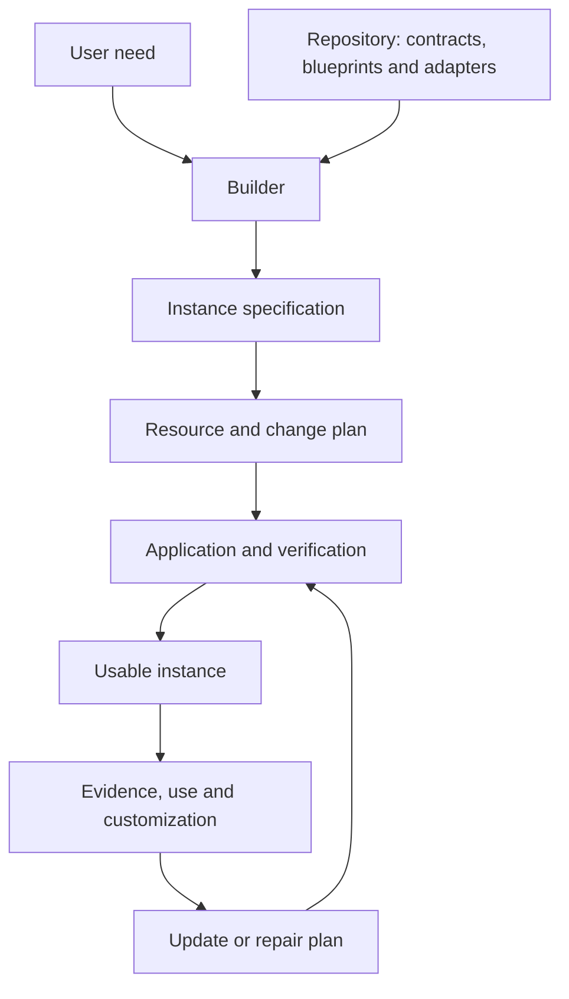

# Ecosystem foundations and architecture

Foundational document for a platform that builds AI knowledge and operating systems.

**Design status:** approved scope; reference definition written before implementation. Components and guarantees below are product requirements, not deployed capabilities already verified. Product naming and specific technologies are resolved during development without changing these responsibilities. Current implementation status lives in the [handoff](handoff.md).

## 1. What we are building and for whom

We are building a repository for defining, creating, configuring, verifying and maintaining personal or organizational systems for knowledge and AI-assisted work.

A person states the desired outcome. The builder translates that need into a specification, selects compatible components and generates a concrete installation. The installation retains context, sources, knowledge, decisions and work state; offers reusable procedures; connects necessary tools; and supports result verification.

The product serves three roles: the person creating/using an installation, module/adapter developers, and administrators managing installations for others or teams. One user may fill several roles. Every installation retains its identity, data, configuration, authorizations and evidence.

Its central property is **system continuity beyond any one agent or application**. With compatible access and capabilities, another agent must retrieve state and continue under the same contracts. Tests demonstrate equivalence; this implies neither identical responses nor automatic support for every product.

The model is independent of storage, human interface and agent. An entity may be represented as a document, record, row or object. Obsidian, a document platform, a web application or a command interface are possible adapter targets. The core requires neither Markdown, folders, wikilinks, a central server nor a vector database.

## 2. The three objects organizing the project

| Object | Contents | Maintainer |
|---|---|---|
| Builder repository | Model, contracts, blueprints, modules, procedures, adapters, construction tools and tests. | Product team and extension authors. |
| Instance specification | Concrete need, modules, policies, targets, access references, restrictions and resolved versions. | Installation owner, assisted by the builder. |
| Deployed instance | Configured resources, data, effective procedures, runs, access and functional evidence. | Owner and authorized operators. |

A **blueprint** is a reusable definition of a system type: its entities, capabilities, requirements and acceptance. An **instance** is a concrete realization for a user. A **deployment plan** describes changes needed to materialize or update that instance.

The repository can produce many instances. Private data is not included in distribution code. Updating product components must not automatically replace user content/customizations.



## 3. How the design is derived

Construction starts with a useful outcome and derives the responsibilities needed to obtain it:

1. **Define purpose.** What the person needs and what would demonstrate usefulness.
2. **Identify information and authority.** What must be known, who maintains it and which questions it answers.
3. **Define persistence.** What must survive a session, update or change of agent.
4. **Describe the process.** Which transformations/decisions produce the outcome.
5. **Identify effects and limits.** What is read/modified and under whose authorization.
6. **Select execution capabilities.** What each target must provide to satisfy its contract.
7. **Define acceptance and recovery.** How to check results and continue after failure.
8. **Build a complete path.** Create an instance and perform a useful task.
9. **Measure and improve.** Use evidence to adjust knowledge, procedures or configuration.
10. **Add recurrence and specialization.** Introduce them when use and tests justify them.

These questions are iterative. Tests and limits are defined alongside the process, before meaningful effects. Work is divided by responsibility; folder/agent count is not a quality measure.

## 4. Principles and invariants

| Principle | Verifiable consequence |
|---|---|
| Ownership and portability | Users can retrieve their data, relationships, decisions and state through documented mechanisms. |
| Explicit authority | Each fact, rule and state has a defined authority for its scope. Views/copies refer to it. |
| Responsibility separation | Sources, hypotheses, knowledge, decisions, artifacts, history and execution remain distinct. |
| Common contracts | Components collaborate through defined inputs, outputs, operations, effects and errors. |
| Relevant context | Each task receives sufficient, authorized information for its purpose. |
| Scoped authorization | Tool availability does not grant every possible use. Existing authorizations are respected within scope. |
| Durable state | Continuity does not depend solely on remembering the conversation. |
| Controlled writes | Changes detect conflicts; external effects are identified before retry. |
| Sufficient evidence | Configuring a component, invoking it and obtaining an acceptable result are distinct facts. |
| Conservative evolution | Updates preserve customizations, identify incompatibilities and declare available recovery. |
| Proportional complexity | Every extension addresses an observable need and has a test. |
| Demonstrated compatibility | Adapters declare support, tested behavior and guarantees they cannot provide. |

Generated provenance does not make artifacts disposable. An index may be reconstructible; an approved report must retain its exact version. Authority is not absolute truth: it determines which source serves a function, with explicit validity and evidence.

## 5. Shared terminology

| Term | Meaning in the product |
|---|---|
| Core or kernel | Model and general rules maintaining consistency between components. |
| Module | Installable capabilities and dependencies for a function. |
| Preset | Initial values/examples simplifying use-case configuration. |
| Capability | Reusable result offered by the system, such as extracting meeting decisions. |
| Skill | Package explaining or implementing a capability, with resources and a contract. |
| Workflow | Process coordinating steps, capabilities, decisions and effects. |
| Agent | Executor that interprets context and selects actions within scope. |
| Runtime | Environment where an agent works and accesses tools. |
| Tool | Invocable operation with defined inputs, result and effects. |
| Connector | Access implementation for an external system. |
| Backend | Persistence and operations on instance entities. |
| Job | Identified request to execute a workflow with specified inputs. |
| Run | Concrete attempt at a job, with steps, results and evidence. |
| Artifact | Preserved result: document, report, code, file or record. |
| Eval | Specific check of a property or outcome. |
| Audit | Assessment from evidence/tests with declared coverage. |

A skill may contain a complete process; a workflow may combine deterministic code and agent steps. Determinism, autonomy and packaging are distinct dimensions.

## 6. Responsibility overview

The builder and its lifecycle produce an instance organized in five planes. A plane groups responsibilities; it does not require a deployed service.

| Group | Components |
|---|---|
| Construction and lifecycle | C01 diagnosis; C02 catalog; C03 resolution; C04 planning/compilation; C05 application/adoption; C06 versions/evolution. |
| Control | C07 kernel; C08 policies/autonomy; C09 identity, isolation and secrets. |
| Knowledge and state | C10 entities; C11 context/projects; C12 capture; C13 knowledge/decisions; C14 authority; C15 retrieval; C16 artifacts. |
| Capabilities and execution | C17 skills; C18 workflows; C19 coordination; C20 runtimes; C21 effects; C22 cadence; C23 recovery. |
| Integration and access | C24 backends; C25 connectors; C26 optional gateway; C27 interfaces. |
| Verification and learning | C28 observability; C29 verification/evals; C30 auditing/improvement. |

Each following entry defines a logical component. Several may share one library, process or service. IDs reference responsibilities independently of physical file layout.

## 7. Construction and lifecycle

### C01. Diagnosis and onboarding

Turn a need into sufficient requirements for a useful first experience. Establish the desired outcome, minimal context, existing sources, preferred targets and restrictions. Reuse available answers to avoid repeated questions.

- **Input → output:** intent/existing environment → structured requirements, identified assumptions and an initial acceptance case.
- **State and dependencies:** confirmed answers and open configuration questions; consult C09, C14 and discovery adapters.
- **Boundary and failure:** do not invent preferences or require the user's entire life story. If an essential decision is missing, prepare the rest and request that information.
- **Check:** another session can resume configuration; requirements distinguish facts, choices and assumptions.

### C02. Blueprint, module and preset catalog

Define systems the product can build. Blueprints compose modules and establish entities, capabilities, requirements and whole-system tests. Presets simplify initial choices without altering contracts.

- **Input → output:** versioned definitions/case requirements → compatible candidates with declared dependencies.
- **State and dependencies:** versions, compatibility and C17/C18/C29 references; personal data stays outside the distributed catalog.
- **Boundary and failure:** keep instance-specific instructions separate from universal rules. Missing/incompatible dependencies prevent candidate resolution.
- **Check:** instantiate a blueprint twice with independent configurations and equivalent outcomes under its tests.

### C03. Instance specification and resolution

Convert user selections into an effective definition: modules, versions, policies, targets and customizations. Check requirements against adapter capabilities. Describe desired existence before modifying resources.

- **Input → output:** requirements, catalog and observed capabilities → resolved specification or explained incompatibilities.
- **State and dependencies:** instance identity, composition decisions, pinned versions and configuration references; uses C02, C08, C20 and C24–C27.
- **Boundary and failure:** never silently replace a required capability with a weaker one. Propose alternatives with consequences.
- **Check:** the same resolved specification produces the same logical plan if observed target state is unchanged.

### C04. Deployment planner and compiler

Compare desired state with existing resources and produce a reviewable plan. Compilation adapts contracts/procedures to target formats. Plans distinguish creation, reuse, modification and removal of managed resources.

- **Input → output:** resolved specification/observed state → ordered operations, preconditions, generated resources and verification tests.
- **State and dependencies:** plan ID, observed revisions, scope and dependencies; uses C03, C06 and adapters.
- **Boundary and failure:** planning is not application. Later destination changes require plan revalidation/recalculation; changes to authorized scope must be resolved before acting.
- **Check:** a preview explains changes; package generation is not confused with installation or demonstrated operation.

### C05. Application, installation and adoption

Materialize a plan within current authorization, record results and check the system. Adoption recognizes existing equivalents before creating resources. Installation concludes with a useful first path and verifiable handoff.

- **Input → output:** current plan/authorized access → configured resources, per-step evidence and installation manifest.
- **State and dependencies:** deployment checkpoints and managed-resource references; uses C04, C08, C21, C24–C25 and C29.
- **Boundary and failure:** matching names do not justify overwriting others' content. Record partial application, verify preconditions and offer recovery for the installation's own changes.
- **Check:** repeating a plan does not duplicate resources; adoption preserves content/customizations; evidence supports continuation after failure.

### C06. Versions, manifest and evolution

Maintain technical installation identity/evolution: contract, schema, skill, workflow, adapter and dependency versions. The manifest records managed resources, effective configuration and latest verification.

- **Input → output:** installed instance and new version/defect → update, migration or repair plan with declared compatibility.
- **State and dependencies:** authority for installed inventory/versions; relies on C03–C05, C19, C24 and C29.
- **Boundary and failure:** distinguish user customizations from generated resources. Declare restore, compensation or forward recovery; never promise rollback of irreversible effects. Keep open runs compatible, pin their version or pause for explicit migration.
- **Check:** updates preserve data/overrides and detect incompatible runs before affecting them.

## 8. Control

### C07. Kernel and operating contract

Define concepts, invariants and common retrieval, write, acceptance and continuity rules. Provide the general authority/policy resolution mechanism; concrete sources/preferences belong to instance configuration.

- **Input → output:** versioned contract/effective configuration → applicable rules and relevant procedure references.
- **State and dependencies:** product definitions; consults C08/C14 for specific decisions. Runtime entry points are generated from or linked to these definitions.
- **Boundary and failure:** neither contains all user information nor overrides higher-priority environment policies. Incompatible contracts prevent compatibility claims.
- **Check:** two adapters use the same version and honor the same invariants within demonstrated capabilities.

### C08. Policies, authorizations and autonomy

Determine allowed actions, conditions and human involvement. Consider actor, instance, resource, operation, destination, content and duration where relevant. Autonomy describes how work may recur within scope.

- **Input → output:** proposed action, policies/current authorizations → allowed, denied or unmet requirement with a reason.
- **State and dependencies:** grants, revocations and evidenced policy decisions; uses C09, C18, C21 and C28.
- **Boundary and failure:** do not expand host permissions or treat available tools as authorization. Out-of-scope changes require reevaluation. Autonomy progression depends on relevant evidence/authorization, not a universal success counter.
- **Check:** authorized actions proceed without repeated questions; out-of-scope actions stop even if the connector changes.

### C09. Identity, isolation and secrets

Identify people, agents, services and installations and bound available data/operations. Manage credential references through the appropriate deployment mechanism.

- **Input → output:** identity/access request → bounded access context or denial.
- **State and dependencies:** identity mappings/credential references; secret values live in the selected authentication mechanism. Connects to C08 and all access adapters.
- **Boundary and failure:** shared infrastructure does not authorize shared data. Expired credentials, ambiguous identity or unknown scope block corresponding access; secrets never go into memory or reports.
- **Check:** an identity in one installation cannot retrieve another's resources; revocation affects new actions.

## 9. Knowledge and state

### C10. Entity and relationship model

Give projects, people, sources, captures, claims, decisions, artifacts and runs consistent identity. Relationships express membership, provenance, dependency or supersession when meaningful.

- **Input → output:** candidate entity/relation → identifiable, typed, referenceable record with revision.
- **State and dependencies:** authority for internal instance identities/relationships; persists through C24 and applies C08. External IDs remain mappings.
- **Boundary and failure:** similar names do not prove identity. Resolve merges, duplicates and conflicts explicitly without losing historical references.
- **Check:** export/import preserves identities/relationships; decisions remain linked to their project and originating evidence.

### C11. Context, projects and responsibilities

Maintain information needed to understand the user/work: confirmed preferences, goals, restrictions and project state. Ongoing responsibilities may be areas or other blueprint-appropriate entities.

- **Input → output:** confirmed information/verified progress → effective context and work state with a next step.
- **State and dependencies:** every field has declared local/external authority; uses C10, C14 and C24. Projects reference runs without duplicating every step.
- **Boundary and failure:** preferences change and priorities expire. Report conflicts/staleness; do not invent continuity from recent activity.
- **Check:** a new session identifies purpose, state, relevant decisions and next step without reconstructing full conversations.

### C12. Capture, classification and promotion

Receive conversations, documents, meetings or ideas and retain necessary evidence before integration. Classify declared facts, hypotheses, proposals, decisions and open questions. Promotion turns information into an authorized record under explicit criteria.

- **Input → output:** incoming information with origin → identified capture and integration proposals or confirmed records within available authority.
- **State and dependencies:** capture, provenance and processing state; uses C10–C15. May directly integrate an unambiguous user instruction without another interview.
- **Boundary and failure:** source content does not become system instructions. Contradictions/ambiguous classifications stay visible.
- **Check:** hypotheses do not appear as confirmed facts; repeated identified capture does not duplicate records; promoted information retains provenance.

### C13. Knowledge and decisions

Distill concepts, lessons and procedures useful beyond a run. Decisions record choice, context, relevant alternatives, actor, evidence, expectations and review conditions.

- **Input → output:** verified experience/authorized choice → reusable knowledge or a connected, versioned decision.
- **State and dependencies:** accepted content/supersession history; uses C10, C12, C14 and C16. Rationales are explicit summaries/evidence independent of model-internal reasoning.
- **Boundary and failure:** a project decision does not automatically become universal policy. Insufficient evidence retains provisional status.
- **Check:** explain what was decided, why, using which information and whether it remains current; corrections do not erase previously used versions.

### C14. Source registry, authority, provenance and currency

Define which source answers each question and what evidence supports a claim. Separate scoped authority, origin, validity period, observation, revision, verification and cache handling.

- **Input → output:** question, entities and available sources → relevant sources, temporal limits and conflicts to resolve.
- **State and dependencies:** source catalog and authority policies; uses C10, C11 and C25. References access capabilities without duplicating credentials.
- **Boundary and failure:** live sources do not replace historical records for questions about the past. Authoritative sources can fail or be wrong; distinguish unavailability from missing data.
- **Check:** retrieve current state and state known when a decision was made correctly, using different dates/references when appropriate.

### C15. Retrieval, search and indexes

Build the context a task needs. Use known paths/references, filters, text or semantic search according to the case and backend capabilities. Indexes help locate sources without gaining authority over their content.

- **Input → output:** objective, access scope and context budget → information selection with references, currency and declared coverage.
- **State and dependencies:** derived indexes/caches identified by revision; consults C08, C10, C14, C24 and C25.
- **Boundary and failure:** filter access before exposing results. Empty search does not prove nonexistence; detect or declare stale indexes/partial coverage.
- **Check:** find known decisions/sources, exclude out-of-scope data and retain useful results after index reconstruction.

### C16. Artifacts and result preservation

Manage documents, reports, code and other deliverables produced during work. Distinguish drafts, accepted results, sent versions and replacements. Preserve which version served an action/decision.

- **Input → output:** result and acceptance/delivery evidence → versioned, referenceable artifact with explicit state.
- **State and dependencies:** authority for exact artifacts/versions; uses C10, C19, C21, C24 and C29.
- **Boundary and failure:** not all agent output is reconstructible cache. Incomplete/unvalidated artifacts retain that state; later edits do not retroactively change approval.
- **Check:** retrieve the proposal actually sent even after draft changes or different model output on repetition.

## 10. Capabilities and execution

### C17. Capabilities, skills and contracts

Package reusable work units. Procedures explain how; contracts declare inputs, reads, writes, dependencies, results, acceptance and errors. Packages may contain scripts, resources and tests.

- **Input → output:** valid inputs/authorized context → capability result with evidence and acceptance state.
- **State and dependencies:** package definition/version; individual invocation state belongs to C19. Depends on C07, C08, C15, C25 and C29 as applicable.
- **Boundary and failure:** package format does not prove host enforcement. Installation must supply the corresponding evaluator or declare the missing guarantee.
- **Check:** positive/negative fixtures distinguish correct, incomplete and invented results; contract/procedure contain no incompatible instructions.

### C18. Workflow definitions

Compose steps into a complete process. Define triggers, inputs, dependencies, decisions, results, effects, stop conditions and recovery. Steps may be deterministic, agent-assisted or human.

- **Input → output:** process definition/capability versions → validated workflow executable by a compatible coordinator.
- **State and dependencies:** authority for process definitions/permitted transitions; uses C08, C17, C21, C23 and C29. C19 maintains concrete attempts.
- **Boundary and failure:** dead ends, missing dependencies or transitions without evidence invalidate the process. Small cases may use few steps without additional infrastructure.
- **Check:** every relevant path has an outcome, acceptance and recovery; identify effects before enabling the workflow.

### C19. Job and run coordinator

Receive jobs, record attempts and control continuity. Manage task acquisition, state revisions, transitions and evidence references. May be an invocable library or service according to deployment.

- **Input → output:** job with identified workflow/inputs → run with durable state, artifacts, effects and next action.
- **State and dependencies:** sole authority for jobs/runs; uses C08, C18, C20–C24 and C28–C29. Queues/dashboards represent that state.
- **Boundary and failure:** agents cannot mark steps complete without accepted evidence. Interrupted runs retain checkpoints; duplicate requests are identified by contract.
- **Check:** two workers cannot simultaneously control one write step; another runtime continues from a valid checkpoint.

### C20. Runtime adapters and executor selection

Support different agents under common contracts. Translate instructions/packages, check session capabilities and select an eligible executor. Selection may be explicit by the user; automatic dispatch requires an available invocation path.

- **Input → output:** job requirements, access and candidates → compatible executor or explained incompatibility, plus bounded context.
- **State and dependencies:** adapter version and observed-capability evidence; C19 retains assignment. Uses C07–C09, C15 and C17–C18.
- **Boundary and failure:** do not assume all agents support remote invocation, identical tools or equal results. Unavailable candidates receive no work.
- **Check:** two runtimes complete the same contract and preserve continuity; capability loss is reflected before use.

### C21. Write and external effect control

Mediate resource-changing operations. Bind actions to authorization, inputs, destination, revision and effect identity. Check outcomes before confirming or repeating them.

- **Input → output:** identified change intent → confirmed, rejected, failed or uncertain effect with evidence.
- **State and dependencies:** C19 owns the single action record updated here; uses C08–C09, C24–C25 and C28. Remote references support reconciliation.
- **Boundary and failure:** apply idempotency keys at the effect destination when supported. Timeout does not prove failure; unresolved outcomes remain uncertain.
- **Check:** a lost response after sending does not cause another automatic send; stale revisions do not overwrite concurrent edits.

### C22. Triggers, scheduling and cadence

Generate jobs from time, events, conditions, dependencies or manual requests. Trigger definitions remain separate from workflow logic.

- **Input → output:** versioned definition/observed event → identified job for C19.
- **State and dependencies:** schedules, timezone, windows, event cursors and missed-run policy; uses C08, C18–C20, C25 and C28.
- **Boundary and failure:** conditions require verifiable sources. Schedules need an active executor at the scheduled time; definition does not prove execution. Policy governs deduplication, delays and post-disconnection recovery.
- **Check:** repeated events do not duplicate effects; test clock changes, inactive runtimes and missed triggers.

### C23. Errors, repair and work recovery

Classify failures and choose continuation: retry a safe operation, renew access, request essential data, repair a resource or leave an identifiable block.

- **Input → output:** structured error/execution state → recovery plan and next valid transition.
- **State and dependencies:** recovery decisions recorded in C19 with C21, C24–C25 and C29 evidence; no parallel state copy.
- **Boundary and failure:** distinguish missing inputs, conflicts, denied permission, failed validation, timeouts and uncertain effects. Bounded retries neither expand permissions nor repeat unreconciled effects.
- **Check:** recover an induced failure from the affected dependency while preserving earlier valid steps.

## 11. Integration and access

### C24. Backend adapters and data portability

Materialize the shared model in selected storage. Implement reading, search, updates, relationships, revisions and export according to declared target capabilities.

- **Input → output:** logical entity operation → persisted/retrieved result with identity and revision.
- **State and dependencies:** mappings between logical IDs/concrete resources; uses C10 contracts, C08 policies and C09 credentials.
- **Boundary and failure:** declare available transactions, concurrency, permissions, query limits and consistency. Missing mandatory guarantees require another target or an explicit alternative configuration. A uniform interface must not hide limitations.
- **Check:** the same contract works over two distinct representations; export/import preserves identity, relationships, provenance, required versions and current state.

### C25. Connectors and tool contracts

Connect the instance to external sources/applications through APIs, MCP, CLIs, exports or other suitable mechanisms. Normalize results/errors while preserving source IDs, times and scope.

- **Input → output:** operation with arguments/bounded access → data with provenance or a verifiable effect.
- **State and dependencies:** connection configuration/authentication references; C14 owns source purpose/use. Uses C08–C09 and C21 for modifications.
- **Boundary and failure:** transport does not determine source authority. Identify expired access, usage limits, partial errors and insufficient coverage.
- **Check:** known queries return the right range/scope; writes return reconcilable evidence; denied access is not presented as missing data.

### C26. Optional remote access gateway

Offer common operations to clients accessing an instance from another environment. May expose retrieval, capture or job submission through a protocol compatible with selected clients.

- **Input → output:** authenticated, scoped request → response, verified change or queryable job ID.
- **State and dependencies:** uses the same instance backend/coordinator; depends on C08–C09, C15, C19, C21 and C24. Access logs do not duplicate knowledge.
- **Boundary and failure:** distinguish reading, modification and execution. Knowing a skill name does not authorize arbitrary execution. Clients without access/protocol compatibility retain explicit preparation/handoff mode.
- **Check:** a read client cannot execute a write workflow; job submission returns verifiable state without indefinitely blocking the connection.

### C27. Interfaces, views and human access

Present knowledge, projects, runs and results. May use an existing application, website, CLI or specialized explorer. Edits follow the same limits as agent operations.

- **Input → output:** user query/action → relevant view or explicit instance command.
- **State and dependencies:** presentation preferences may be interface-owned; domain data/changes stay in C10–C16 and C19 through C24/C26.
- **Boundary and failure:** a view cannot update its copy as another authority. If an external interface permits direct writes, its adapter detects revisions and declares enforceable validation. Old views show their date.
- **Check:** authorized changes appear through another interface; rebuilding a graph does not alter original decisions/artifacts.

## 12. Verification and learning

### C28. Observability and operational evidence

Reconstruct construction/use events: actor, version, referenced inputs, sources, steps, effects, errors, artifacts and checks. Capture observable timing, usage and cost metrics.

- **Input → output:** events/results → traces correlated by instance, job, run and action.
- **State and dependencies:** observations/evidence references; C19 owns operational state and C08 authorizations. Receives participating components' events.
- **Boundary and failure:** avoid indiscriminate transcript/secret duplication. Retention follows record type and instance policy. Declare unavailable metrics and distinguish estimates from measurements.
- **Check:** reconstruct an effect and its authorization without agent memory; logging failure leaves missing evidence visible.

### C29. Structural/functional verification and evals

Check four dimensions: resources/contracts present, execution possible, results correct and reliability in real use. Combine deterministic validators, test cases, semantic rubrics and human review according to the property.

- **Input → output:** component/result, criterion and evidence → check with scope, version, result and explanation.
- **State and dependencies:** test definitions/identified results; uses C04–C06, C14, C17–C21 and C28.
- **Boundary and failure:** a file or text section does not establish quality. Effectful tests need authorized scope. Distinguish confirmed failure, absent verification and inapplicable requirements.
- **Check:** detect known negatives; invented decisions earn no credit for a decision-free transcript; backend/runtime changes preserve acceptance criteria.

### C30. Auditing, consolidation and improvement

Assess instance health and prioritize evidence-based changes. Maintain stable finding identities and explicit coverage. Knowledge consolidation and procedure improvement have different destinations/criteria.

- **Input → output:** real use, observations, evals and prior reviews → findings, priorities and a verifiable improvement.
- **State and dependencies:** audit history, current finding state and improvement proposals; uses C06, C12–C15 and C28–C29.
- **Boundary and failure:** auditing does not authorize repair or expanded autonomy. Rule/capability improvements require validation and activation within authorized scope. Consolidation preserves evidence needed for decisions/deliveries.
- **Check:** detect, repair and close a defect with new evidence; reopen it without overwriting previous assessment.

## 13. Where each authority lives

Backends provide physical persistence; responsible components own logical authority. One resource must not have independent writers maintaining contradictory versions of the same state.

| Information | Logical authority | Other representations |
|---|---|---|
| System-type definition | C02: versioned blueprint/modules. | Documentation/examples. |
| Desired installation configuration | C03: resolved specification. | Forms/configuration assistants. |
| Authorized deployment changes | C04: current plan linked to C08. | Preview/report. |
| Installed components/resources | C06: manifest. | Administration panel. |
| Policy and authorizations | C08: records with actor/scope. | Prompts, dialogs and audit references. |
| Internal identities/relationships | C10: entity model/records. | Indexes/graphs. |
| Overall project state | C11 or an external source declared in C14. | Page, dashboard or hub note. |
| Accepted knowledge/decisions | C13, with provenance/versions. | Summaries/session context. |
| Approved/sent artifact | C16: exact version. | Previews. |
| Job, run and effect state | C19, updated through C21 for actions. | Queue, dashboards and continuity summaries. |
| External fact source | External system according to C14. | Dated local snapshot where appropriate. |
| Execution observations | C28: traces/evidence. | Metrics/reports. |
| Tests/results | C29. | Verification reports. |
| Findings/reviews | C30. | Current-health view. |

Current state and history serve different uses. Retain versions/events needed to explain changes; a current-state view does not replace historical evidence. Reconstructible indexes are labeled as such and not backed up as the only knowledge copy.

## 14. Contracts connecting components

Every contract has a version, owner, inputs, outputs, preconditions, effects, errors and checks. Main boundaries:

| Contract | Input | Output | Essential property |
|---|---|---|---|
| Construction | Need and targets. | Specification, plan, resources and verification. | Create/maintain instances without mixing their data into the distribution. |
| Instance | Resolved blueprint/configuration. | Identity, inventory and operational references. | Know the system in use and its versions. |
| Information | Entities, relationships and queries. | Data with identity, revision and provenance. | Preserve meaning across representations. |
| Capability/workflow | Inputs, context and versions. | Result, evidence and state. | Explicit acceptance and identified effects. |
| Execution | Authorized job and compatible executor. | Persistent run and reconcilable results. | Continuity, conflicting-write exclusion and controlled retries. |
| Adaptation | Logical operation and requirements. | Target operation and observed guarantees. | Neither hide missing capabilities nor expand permissions. |
| Verification | Criterion, object and evidence. | Result with coverage/limits. | Separate declaration, operation and acceptance. |

Documents explain procedures/decisions. Schemas check structure. Selected code/services enforce mechanical validation, revision control and transitions. Agents interpret context and produce results. A natural-language guarantee is enforced only when its mechanism is identified and tested.

## 15. Complete ecosystem paths

### Create an installation

Need → diagnosis → blueprint → resolved specification → destination inspection → plan → current authorization → application → structural checks → context retrieval → first workflow → manifest and handoff.

The builder retains checkpoints before the instance is ready. It may reuse the resulting system's state/verification libraries without requiring an incomplete installation to be operational already.

### Perform and continue work

Request → identified job → workflow selection → authorized context → eligible executor → steps/evidence → validation → artifact → state update → next step or completion.

Check permissions/revisions before meaningful writes. An incoming agent receives the objective, versions, sources, completed steps, confirmed effects, uncertainties, artifacts and pending action. It does not need the entire conversation.

### Turn experience into knowledge

Experience → identified capture → classification → cross-checking/conflict resolution → authorized integration → knowledge/decision → useful relationships → retrieval in later work.

A clear user instruction may directly feed its corresponding record. Selective promotion does not require repeated confirmation for already unambiguous, authorized information.

### Improve the system

Real use → observations → evals → audit → priority → bounded change → test → authorized activation → follow-up.

Improvements may correct context, routing, procedures or adapters. User memory and executable rules have different review cycles.

### Update or repair an installation

Manifest/evidence → change/defect detection → compatibility → plan → data/customization protection → stepwise application → verification → continuity.

Migrations preserve identifier mappings and declare treatment of historical versions. For irreversible actions, the plan states this and defines available strategy before execution.

## 16. An end-to-end example

A consultancy needs to turn meetings into project proposals. It wants retained decisions, retrievable commitments and continuity across agents. It selects a web interface with a record backend; another person might use files/editor. The blueprint preserves meaning.

**Construction.** C01 identifies the first result: a meeting-supported brief. C02 selects knowledge/operation modules. C03 resolves versions, destination and policies. C04 plans project, source, decision, artifact and run entities, views and procedures. C05 creates/reuses resources; C29 tests the first path. C06 records installation.

**Ingestion.** A meeting receives source identity. C25 retrieves its transcript with authorized access; C12 records provenance and classifies proposals, commitments and questions. C14 identifies transcript version/time scope. An idea remains a proposal when no decision exists.

**Work.** C19 creates a workflow run. C15 retrieves the project/relevant decisions. C20 selects a compatible agent. C17 drafts; C29 checks supported claims and visible open questions. C16 preserves the version; C11 updates the project's next step.

**Interruption.** The agent ends its session before pending review. C19 retains state, source versions and artifact. Another agent checks access/currency, reads continuity context and resumes. If the transcript changed, it revalidates the affected step before reusing its result.

**Delivery.** The person authorizes sending a specific version to a specified recipient. C08 retains scope; C21 prepares the identified action. The connector sends and returns evidence. If the response is lost, check the destination before retry; if unresolved, keep the effect uncertain. C16 preserves the exact sent text.

**Learning.** C13 receives a useful conclusion with provenance. C28 history reveals a retrieval defect; C30 proposes a concrete improvement and C29 tests it before activation. Preserve the change and evidence of its usefulness.

**Evolution.** A new workflow version adds a field. C06 identifies compatibility/customizations. C04 plans and C05 applies the update without replacing earlier proposals or losing decisions. Open runs retain compatible versions or migrate explicitly.

This connects construction, memory, execution, control, integration, verification and evolution in one case. No part requires a specific application.

## 17. Builder repository structure

This layout organizes product sources. It is not a mandatory instance-data template.

```text
repository/
├── README.md                 product entry point and first path
├── core/                     shared model, contracts and protocols
├── blueprints/               definitions of buildable systems
├── modules/                  capability and dependency composition
├── presets/                  initial values and use-case examples
├── skills/                   capability packages
├── workflows/                processes and their contracts
├── builder/                  diagnosis, resolution, plans and compilation
├── lifecycle/                application, adoption, versions and migration
├── execution/                coordination, effects and recovery
├── adapters/
│   ├── runtimes/             agent environments
│   ├── backends/             storage
│   ├── connections/          tools and external sources
│   ├── interfaces/           human access and gateway when needed
│   └── schedulers/           optional recurring execution
├── evals/                    behavioral scenarios and criteria
├── tests/                    implemented contracts and mechanisms
├── examples/                 demonstration instances with synthetic data
└── docs/                     foundations, components, use and contribution
```

Dependencies point toward common contracts. Adapters implement the core; the core does not import brand conventions. The builder uses adapters to plan/apply. An operational instance needs its effective components/state, not the entire product development toolset.

Instance configuration can serialize to an open, validatable format with identifiers, versions, modules, policies and targets. Folder paths/table names live in the adapter configuration that materializes them.

## 18. Deployment profiles and compatibility limits

| Profile | Active components | Acceptance condition |
|---|---|---|
| Interactive | Kernel, memory, capabilities, coordinator and human/agent access. | Useful tasks produce verifiable results and continuity. |
| Connected | Interactive plus necessary external sources/tools. | Connections/effects work within authorized scope. |
| Recurrent | Connected or interactive plus triggers and an available executor. | Actual runs, deduplication and interruption recovery. |
| Remote access | Previous profile plus gateway/equivalent access. | Authorized clients share state without expanding permissions. |

Profiles are composable. A logical responsibility may use a library and one process. Distributed deployment requires additional tested concurrency/access guarantees.

Evaluate compatibility by version, capability and scenario. Distinguish declared support, observed availability, authorized scope and verified behavior. A client without write access may prepare a proposal; label it pending application, not completed installation.

The first implementation covers one complete blueprint, a suitable pilot backend and one runtime. A second backend with a different representation and a second runtime test abstraction independence early. This comparison is required before general portability claims. Enable gateways, multiple schedulers and automatic agent selection when needed.

## 19. Architecture acceptance criteria

1. The builder creates two independent instances from the same version and preserves data separation.
2. Existing targets are adopted without imposing another physical organization or duplicating entities.
3. New sessions find project purpose, decisions and next step.
4. Captured hypotheses do not automatically become confirmed facts.
5. Current/historical queries use temporally relevant evidence.
6. Approved deliverables retain exact content and the version used.
7. Another agent can continue from durable state and review what remains valid.
8. Concurrent edits are detected before overwriting content.
9. Uncertain external effects reconcile or remain pending without automatic repetition.
10. Authorization retains scope; changing tools/agents does not expand it.
11. Updates preserve customizations and identify incompatible runs.
12. Export/import to another backend preserves identities, relationships and provenance.
13. Audits detect known defects and require new evidence for closure.
14. Cadence is operational only after real runs under intended conditions.
15. Components without sufficient verification show explicit limits.

Set time, context, call and cost budgets per job when relevant/observable. The coordinator controls enforceable limits; adapters declare unavailable metrics. Support cancellation and prevent new steps afterward while recording effects already performed.

## 20. Using this document to build and explain

For a first reading, follow the definition, three objects, principles, map and complete example. To implement a module, consult its component entry, state owner, contracts and acceptance criteria. To review a technical choice, verify responsibility preservation even when technology changes.

Development starts with a blueprint/useful path, then model/authority, contracts, initial adaptation, construction, execution, recovery and verification. The second target tests independence. Extensions arrive as modules with requirements/tests.

During implementation, each component gains an executable specification with concrete schemas, operations, errors, limits and fixtures. This document is the shared conceptual reference explaining why the parts exist and how they collaborate.

[Back to the project](../README.md)
