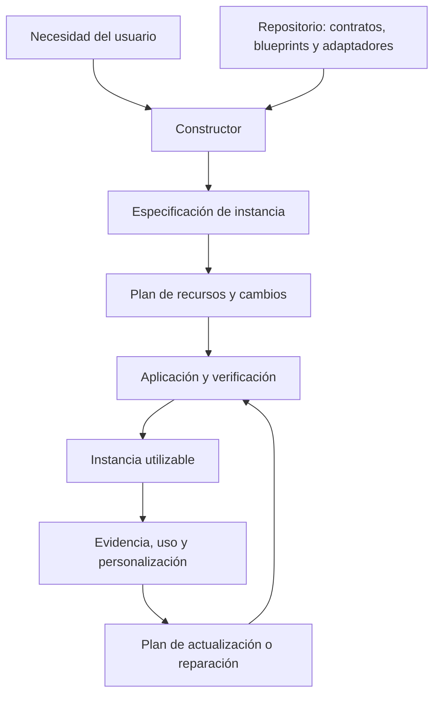

# Fundamentos y arquitectura del ecosistema

Documento fundacional de una plataforma constructora de sistemas de conocimiento y operación con IA.

**Estado del proyecto:** alcance aprobado; definición previa a implementación. Este documento establece el diseño de referencia. Los componentes y garantías descritos son requisitos del producto, no capacidades desplegadas que ya se hayan verificado. El nombre comercial y las tecnologías concretas se resolverán durante el desarrollo sin alterar las responsabilidades aquí definidas.

## 1. Qué construimos y para quién

Construimos un repositorio que permite definir, crear, configurar, verificar y mantener sistemas personales u organizacionales de conocimiento y trabajo asistido por IA.

Una persona expresa qué necesita conseguir. El constructor traduce esa necesidad a una especificación, selecciona componentes compatibles y genera una instalación concreta. Esa instalación conserva contexto, fuentes, conocimiento, decisiones y estado de trabajo; ofrece procedimientos reutilizables; conecta las herramientas necesarias; y permite verificar los resultados.

El producto sirve a tres perfiles: la persona que crea y utiliza una instalación; quien desarrolla módulos o adaptadores; y quien administra instalaciones para otras personas o equipos. Un usuario puede asumir varios papeles. Cada instalación conserva su identidad, datos, configuración, autorizaciones y evidencia.

La propiedad central es la **continuidad del sistema más allá de un agente o aplicación**. Con acceso y capacidades compatibles, otro agente debe poder recuperar el estado y continuar el trabajo bajo los mismos contratos. La equivalencia se demuestra mediante pruebas; no implica respuestas idénticas ni soporte automático de todos los productos.

El modelo es independiente del almacenamiento, de la interfaz humana y del agente. Una entidad puede materializarse como documento, registro, fila u objeto. Obsidian, una plataforma documental, una aplicación web o una interfaz de comandos son posibles destinos mediante adaptadores. El núcleo no exige Markdown, carpetas, wikilinks, un servidor central ni una base vectorial.

## 2. Los tres objetos que organizan todo el proyecto

| Objeto | Qué contiene | Quién lo mantiene |
|---|---|---|
| Repositorio constructor | Modelo, contratos, blueprints, módulos, procedimientos, adaptadores, herramientas de construcción y pruebas. | Equipo del producto y autores de extensiones. |
| Especificación de instancia | Necesidad concreta, módulos, políticas, destinos, referencias de acceso, restricciones y versiones resueltas. | Propietario de la instalación, con asistencia del constructor. |
| Instancia desplegada | Recursos configurados, datos, procedimientos efectivos, ejecuciones, acceso y evidencia de funcionamiento. | Propietario y operadores autorizados. |

Un **blueprint** es una definición reutilizable de un tipo de sistema: describe sus entidades, capacidades, requisitos y aceptación. Una **instancia** es la realización concreta para un usuario. Un **plan de despliegue** describe los cambios necesarios para materializar o actualizar esa instancia.

El repositorio puede producir muchas instancias. Sus datos privados no se incorporan al código de distribución. Actualizar componentes del producto no debe reemplazar automáticamente el contenido o las personalizaciones de los usuarios.



## 3. La estructura mental que explica el diseño

La construcción parte de un resultado útil y deriva las responsabilidades necesarias para obtenerlo:

1. **Definir el propósito.** Qué resultado necesita la persona y qué demostraría que le sirve.
2. **Identificar información y autoridad.** Qué se necesita saber, quién lo mantiene y para qué preguntas es válido.
3. **Definir persistencia.** Qué debe sobrevivir a una sesión, una actualización o un cambio de agente.
4. **Describir el proceso.** Qué transformaciones y decisiones producen el resultado.
5. **Identificar efectos y límites.** Qué se lee, qué se modifica y con qué autorización.
6. **Seleccionar capacidades de ejecución.** Qué debe ofrecer cada destino para cumplir el contrato.
7. **Definir aceptación y recuperación.** Cómo comprobar el resultado y continuar ante un fallo.
8. **Construir un recorrido completo.** Crear una instancia y realizar una tarea útil.
9. **Medir y mejorar.** Usar evidencia para ajustar conocimiento, procedimientos o configuración.
10. **Añadir recurrencia y especialización.** Incorporarlas cuando el uso y las pruebas lo justifiquen.

Estas preguntas se iteran. Las pruebas y los límites se definen junto al proceso, antes de ejecutar efectos relevantes. El trabajo se divide por responsabilidades; el número de carpetas o agentes no es una medida de calidad.

## 4. Principios e invariantes

| Principio | Consecuencia verificable |
|---|---|
| Propiedad y portabilidad | El usuario puede recuperar sus datos, relaciones, decisiones y estado mediante mecanismos documentados. |
| Autoridad explícita | Cada dato, regla y estado tiene una autoridad definida para su ámbito. Las vistas y copias remiten a ella. |
| Separación de responsabilidades | Fuente, hipótesis, conocimiento, decisión, artefacto, historial y ejecución no se confunden. |
| Contratos comunes | Los componentes colaboran mediante entradas, salidas, operaciones, efectos y errores definidos. |
| Contexto pertinente | Cada tarea recibe información suficiente y autorizada para su propósito. |
| Autorización con alcance | Disponer de una herramienta no concede permiso para cualquier uso de ella. Las autorizaciones vigentes se respetan dentro de su alcance. |
| Estado durable | La continuidad no depende exclusivamente de recordar la conversación. |
| Escrituras controladas | Los cambios detectan conflictos y los efectos externos se identifican antes de reintentarlos. |
| Evidencia suficiente | Configurar un componente, invocarlo y obtener un resultado aceptable son hechos distintos. |
| Evolución conservadora | Actualizar preserva personalizaciones, identifica incompatibilidades y declara recuperación disponible. |
| Complejidad proporcional | Cada extensión responde a una necesidad observable y dispone de una prueba. |
| Compatibilidad demostrada | Un adaptador declara qué soporta, qué ha probado y qué no puede garantizar. |

La procedencia generada no hace descartable un artefacto. Un índice puede ser reconstruible; un informe aprobado necesita conservar su versión exacta. La autoridad tampoco equivale a verdad absoluta: determina qué fuente se utiliza para una función, con vigencia y evidencia explícitas.

## 5. Lenguaje común

| Término | Significado dentro del producto |
|---|---|
| Núcleo o kernel | Modelo y reglas generales que mantienen coherencia entre componentes. |
| Módulo | Conjunto instalable de capacidades y dependencias para una función. |
| Preset | Valores iniciales y ejemplos que facilitan configurar un caso de uso. |
| Capability | Resultado reutilizable que el sistema ofrece, como extraer decisiones de una reunión. |
| Skill | Paquete que explica o implementa una capacidad, con recursos y contrato. |
| Workflow | Proceso que coordina pasos, capacidades, decisiones y efectos. |
| Agente | Ejecutor capaz de interpretar contexto y elegir acciones dentro de su alcance. |
| Runtime | Entorno donde trabaja el agente y desde el que accede a herramientas. |
| Herramienta | Operación invocable con entradas, resultado y efectos definidos. |
| Conector | Implementación del acceso a un sistema externo. |
| Backend | Persistencia y operaciones sobre las entidades de una instancia. |
| Job o trabajo | Petición identificada de ejecutar un workflow con determinadas entradas. |
| Run o ejecución | Intento concreto de realizar un trabajo, con pasos, resultados y evidencia. |
| Artefacto | Resultado conservado: documento, informe, código, archivo o registro. |
| Eval | Comprobación específica de una propiedad o resultado. |
| Auditoría | Valoración del sistema a partir de evidencia y pruebas con cobertura declarada. |

Una skill puede contener un proceso completo y un workflow puede combinar código determinista con pasos de agente. Determinismo, autonomía y empaquetado son dimensiones distintas.

## 6. Mapa general de responsabilidades

El constructor y su ciclo de vida producen una instancia organizada en cinco planos. Un plano agrupa responsabilidades; no exige un servicio desplegado.

| Grupo | Componentes |
|---|---|
| Construcción y ciclo de vida | C01 Diagnóstico; C02 catálogo; C03 resolución; C04 planificación y compilación; C05 aplicación y adopción; C06 versiones y evolución. |
| Control | C07 núcleo; C08 políticas y autonomía; C09 identidad, aislamiento y secretos. |
| Conocimiento y estado | C10 entidades; C11 contexto y proyectos; C12 captura; C13 conocimiento y decisiones; C14 autoridad; C15 recuperación; C16 artefactos. |
| Capacidades y ejecución | C17 skills; C18 workflows; C19 coordinación; C20 runtimes; C21 efectos; C22 cadencia; C23 recuperación. |
| Integración y acceso | C24 backends; C25 conectores; C26 gateway opcional; C27 interfaces. |
| Verificación y aprendizaje | C28 observabilidad; C29 verificación y evals; C30 auditoría y mejora. |

Cada ficha siguiente define un componente lógico. Varios pueden implementarse en una misma biblioteca, proceso o servicio. Los identificadores permiten referenciar responsabilidades sin depender de una estructura física de archivos.

## 7. Construcción y ciclo de vida

### C01. Diagnóstico y onboarding

Transforma una necesidad en requisitos suficientes para construir una primera experiencia útil. Averigua el resultado buscado, contexto mínimo, fuentes existentes, destinos preferidos y restricciones. Puede recuperar respuestas ya disponibles para no volver a preguntar.

- **Entrada → salida:** intención y entorno existente → requisitos estructurados, supuestos identificados y caso inicial de aceptación.
- **Estado y dependencias:** conserva respuestas confirmadas y cuestiones abiertas de la configuración; consulta C09, C14 y los adaptadores de detección.
- **Límite y fallo:** no inventa preferencias ni necesita conocer toda la vida del usuario. Si falta una decisión imprescindible, prepara el resto y solicita esa información.
- **Comprobación:** otra sesión puede retomar la configuración; los requisitos distinguen hechos, elecciones y supuestos.

### C02. Catálogo de blueprints, módulos y presets

Define qué sistemas puede construir el producto. Cada blueprint compone módulos y establece entidades, capacidades, requisitos y pruebas del sistema completo. Los presets facilitan elecciones iniciales sin alterar los contratos.

- **Entrada → salida:** definiciones versionadas y requisitos del caso → candidatos compatibles con dependencias declaradas.
- **Estado y dependencias:** mantiene versiones, compatibilidad y referencias a C17, C18 y C29; los datos personales permanecen fuera del catálogo distribuido.
- **Límite y fallo:** no mezcla instrucciones particulares de una instancia con reglas universales. Una dependencia ausente o incompatible impide resolver ese candidato.
- **Comprobación:** un blueprint puede instanciarse dos veces con configuraciones independientes y resultados equivalentes según sus pruebas.

### C03. Especificación y resolución de instancia

Convierte la selección del usuario en una definición efectiva: módulos, versiones, políticas, destinos y personalizaciones. Comprueba requisitos frente a las capacidades de los adaptadores. Esta definición describe qué debe existir, antes de modificar recursos.

- **Entrada → salida:** requisitos, catálogo y capacidades observadas → especificación resuelta o incompatibilidades explicadas.
- **Estado y dependencias:** conserva identidad de instancia, decisiones de composición, versiones fijadas y referencias de configuración; usa C02, C08, C20 y C24–C27.
- **Límite y fallo:** no sustituye silenciosamente una capacidad obligatoria por otra más débil. Propone alternativas con sus efectos.
- **Comprobación:** la misma especificación resuelta produce el mismo plan lógico cuando el estado observado de los destinos no cambia.

### C04. Planificador y compilador de despliegue

Compara el estado deseado con los recursos existentes y produce un plan revisable. La compilación adapta contratos y procedimientos a los formatos del destino. El plan distingue crear, reutilizar, modificar y retirar recursos gestionados.

- **Entrada → salida:** especificación resuelta y estado observado → operaciones ordenadas, precondiciones, recursos generados y pruebas de verificación.
- **Estado y dependencias:** el plan conserva identificador, revisiones observadas, alcance y dependencias; emplea C03, C06 y adaptadores.
- **Límite y fallo:** planificar no implica aplicar. Un cambio posterior en el destino exige revalidar o recalcular el plan y, si cambia el alcance autorizado, resolverlo antes de actuar.
- **Comprobación:** una vista previa explica qué cambiará; generar un paquete no se confunde con instalarlo ni demostrar su funcionamiento.

### C05. Aplicador, instalación y adopción

Materializa un plan dentro de la autorización vigente, registra resultados y comprueba el sistema. En adopción reconoce equivalencias existentes antes de crear recursos. Una instalación termina con un primer recorrido útil y un handoff verificable.

- **Entrada → salida:** plan vigente y acceso autorizado → recursos configurados, evidencia por paso y manifiesto de instalación.
- **Estado y dependencias:** escribe checkpoints del despliegue y referencias a recursos gestionados; usa C04, C08, C21, C24–C25 y C29.
- **Límite y fallo:** no sobrescribe contenido ajeno por coincidir un nombre. Ante aplicación parcial registra lo ocurrido, verifica precondiciones y ofrece recuperación de los cambios propios.
- **Comprobación:** repetir el plan no duplica recursos; adoptar preserva contenido y personalizaciones; un fallo permite continuar desde evidencia.

### C06. Versiones, manifiesto y evolución

Mantiene la identidad técnica de la instalación y su evolución: versiones de contratos, esquemas, skills, workflows, adaptadores y dependencias. El manifiesto registra recursos gestionados, configuración efectiva y última verificación.

- **Entrada → salida:** instancia instalada y nueva versión o defecto → plan de actualización, migración o reparación con compatibilidad declarada.
- **Estado y dependencias:** es autoridad del inventario instalado y de sus versiones; se apoya en C03–C05, C19, C24 y C29.
- **Límite y fallo:** diferencia personalización del usuario de recursos generados. Declara si la recuperación permite restaurar, compensar o avanzar; no promete rollback de efectos irreversibles. Las ejecuciones abiertas se mantienen compatibles, se fijan a su versión o se pausan para migración explícita.
- **Comprobación:** una actualización conserva datos y overrides y detecta una ejecución incompatible antes de afectarla.

## 8. Control

### C07. Núcleo y contrato operativo

Define conceptos, invariantes y reglas comunes de recuperación, escritura, aceptación y continuidad. Contiene el mecanismo general para resolver autoridad y políticas; las fuentes concretas y preferencias pertenecen a la configuración de cada instancia.

- **Entrada → salida:** contrato versionado y configuración efectiva → reglas aplicables y referencias a procedimientos pertinentes.
- **Estado y dependencias:** mantiene definiciones del producto; consulta C08 y C14 para decisiones específicas. Las entradas de cada runtime se generan o vinculan desde esas definiciones.
- **Límite y fallo:** no incluye toda la información del usuario ni sustituye las políticas superiores del entorno. Un contrato incompatible impide declarar compatibilidad.
- **Comprobación:** dos adaptadores usan la misma versión y respetan los mismos invariantes dentro de sus capacidades demostradas.

### C08. Políticas, autorizaciones y autonomía

Determina qué acciones están permitidas, bajo qué condiciones y con qué intervención humana. Considera actor, instancia, recurso, operación, destino, contenido y duración cuando sean relevantes. La autonomía describe cómo puede repetirse el trabajo dentro de ese alcance.

- **Entrada → salida:** acción propuesta, políticas y autorizaciones vigentes → permitido, denegado o requisito pendiente con motivo.
- **Estado y dependencias:** conserva concesiones, revocaciones y decisiones de política con evidencia; usa C09, C18, C21 y C28.
- **Límite y fallo:** no amplía permisos del host ni trata herramientas disponibles como autorización. Una modificación fuera del alcance concedido exige reevaluación. El progreso de autonomía depende de evidencia pertinente y de autorización, no de un contador universal de éxitos.
- **Comprobación:** una acción autorizada continúa sin preguntas repetidas; una acción fuera de alcance se detiene incluso al cambiar de conector.

### C09. Identidad, aislamiento y secretos

Identifica personas, agentes, servicios e instalaciones y limita qué datos y operaciones puede usar cada uno. Gestiona referencias a credenciales mediante el mecanismo adecuado al despliegue.

- **Entrada → salida:** identidad y petición de acceso → contexto de acceso acotado o denegación.
- **Estado y dependencias:** mantiene asociaciones de identidad y referencias de credenciales; los valores secretos viven en el mecanismo de autenticación elegido. Se conecta con C08 y todos los adaptadores de acceso.
- **Límite y fallo:** compartir infraestructura no autoriza compartir datos. Credenciales vencidas, identidad ambigua o ámbito desconocido bloquean el acceso correspondiente; no se copian secretos a memorias o reportes.
- **Comprobación:** una identidad de una instalación no puede recuperar recursos de otra; la revocación surte efecto en nuevas acciones.

## 9. Conocimiento y estado

### C10. Modelo de entidades y relaciones

Da una identidad coherente a proyectos, personas, fuentes, capturas, afirmaciones, decisiones, artefactos y ejecuciones. Las relaciones indican pertenencia, procedencia, dependencia o sustitución cuando aportan significado.

- **Entrada → salida:** entidad o relación candidata → registro identificable, tipado y referenciable con revisión.
- **Estado y dependencias:** es autoridad de identidades y relaciones internas de la instancia; persiste mediante C24 y aplica C08. Los identificadores externos se conservan como correspondencias.
- **Límite y fallo:** dos nombres parecidos no demuestran identidad. Fusiones, duplicados y conflictos se resuelven explícitamente sin perder referencias históricas.
- **Comprobación:** exportar e importar conserva identidades y relaciones; una decisión sigue enlazada al proyecto y a la evidencia que la originó.

### C11. Contexto, proyectos y responsabilidades

Mantiene la información necesaria para entender al usuario y su trabajo: preferencias confirmadas, objetivos, restricciones y estado de proyectos. Una responsabilidad continua puede representarse como área u otra entidad pertinente al blueprint.

- **Entrada → salida:** información confirmada y avances verificados → contexto efectivo y estado de trabajo con siguiente paso.
- **Estado y dependencias:** cada campo tiene autoridad local o externa declarada; usa C10, C14 y C24. El proyecto referencia sus ejecuciones; no duplica todos sus pasos.
- **Límite y fallo:** una preferencia puede cambiar y una prioridad puede caducar. Conflictos o falta de vigencia se comunican; no se inventa continuidad a partir de actividad reciente.
- **Comprobación:** una sesión nueva identifica propósito, estado, decisiones relevantes y siguiente paso sin reconstruir conversaciones completas.

### C12. Captura, clasificación y promoción

Recibe conversaciones, documentos, reuniones o ideas y conserva la evidencia necesaria antes de integrarla. Clasifica hechos declarados, hipótesis, propuestas, decisiones y preguntas abiertas. Promover significa convertir información en un registro autorizado mediante un criterio explícito.

- **Entrada → salida:** información entrante con origen → captura identificada y propuestas de integración o registros confirmados dentro de la autorización disponible.
- **Estado y dependencias:** conserva captura, procedencia y estado de procesamiento; utiliza C10–C15. Puede integrar directamente una instrucción inequívoca del usuario sin imponer otra entrevista.
- **Límite y fallo:** el contenido de una fuente no se convierte en instrucciones para el sistema. Las contradicciones y clasificaciones ambiguas permanecen visibles.
- **Comprobación:** una hipótesis no aparece como hecho confirmado; repetir una captura identificada no duplica registros; la información promovida conserva procedencia.

### C13. Conocimiento y decisiones

Destila conceptos, aprendizajes y procedimientos que sirven fuera de una ejecución. Las decisiones registran elección, contexto, alternativas pertinentes, actor, evidencia, expectativas y condiciones de revisión.

- **Entrada → salida:** experiencia verificada o elección autorizada → conocimiento reutilizable o decisión versionada y conectada.
- **Estado y dependencias:** mantiene contenido aceptado e historial de sustituciones; usa C10, C12, C14 y C16. Las justificaciones son resúmenes explícitos y evidencia, sin depender del razonamiento interno de un modelo.
- **Límite y fallo:** una decisión válida en un proyecto no se convierte automáticamente en política universal. Evidencia insuficiente conserva el carácter provisional.
- **Comprobación:** puede explicarse qué se decidió, por qué, con qué información y si sigue vigente; una corrección no borra la versión usada anteriormente.

### C14. Registro de fuentes, autoridad, procedencia y vigencia

Define qué fuente responde a cada pregunta y qué evidencia sustenta una afirmación. Separa autoridad por ámbito, origen, periodo de validez, observación, revisión, verificación y tratamiento de caché.

- **Entrada → salida:** pregunta, entidades y fuentes disponibles → fuentes pertinentes, límites temporales y conflictos que deben resolverse.
- **Estado y dependencias:** mantiene el catálogo de fuentes y sus políticas de autoridad; usa C10, C11 y C25. Referencia capacidades de acceso sin duplicar las credenciales.
- **Límite y fallo:** una fuente viva no sustituye un registro histórico cuando se pregunta por el pasado. Una fuente autorizada puede fallar o contener errores; se distingue indisponibilidad de ausencia de datos.
- **Comprobación:** el estado actual y el estado conocido al tomar una decisión se recuperan correctamente, con fechas y referencias diferentes cuando corresponde.

### C15. Recuperación, búsqueda e índices

Construye el contexto necesario para una tarea. Utiliza rutas o referencias conocidas, filtros, búsqueda textual o semántica según el caso y las capacidades del backend. Los índices facilitan encontrar fuentes y no adquieren autoridad sobre su contenido.

- **Entrada → salida:** objetivo, alcance de acceso y presupuesto de contexto → selección de información con referencias, vigencia y cobertura declaradas.
- **Estado y dependencias:** mantiene índices y cachés derivados identificados por revisión; consulta C08, C10, C14, C24 y C25.
- **Límite y fallo:** filtra el acceso antes de exponer resultados. Una búsqueda sin resultados no prueba que el dato no exista; índices obsoletos o cobertura parcial se detectan o declaran.
- **Comprobación:** encuentra decisiones y fuentes conocidas, evita datos fuera del alcance y mantiene resultados útiles al reconstruir sus índices.

### C16. Artefactos y preservación de resultados

Gestiona documentos, informes, código y otros entregables producidos durante el trabajo. Distingue borrador, resultado aceptado, versión enviada y sustituciones. Conserva qué versión se utilizó para una acción o decisión.

- **Entrada → salida:** resultado y evidencia de aceptación o entrega → artefacto versionado, referenciable y con estado explícito.
- **Estado y dependencias:** es autoridad del artefacto exacto y sus versiones; utiliza C10, C19, C21, C24 y C29.
- **Límite y fallo:** no clasifica todo output del agente como caché reconstruible. Un artefacto incompleto o no validado mantiene ese estado; una edición posterior no altera retrospectivamente lo aprobado.
- **Comprobación:** se recupera la propuesta realmente enviada aunque el borrador actual haya cambiado o el modelo produzca un texto distinto al repetir la tarea.

## 10. Capacidades y ejecución

### C17. Capacidades, skills y contratos

Empaqueta unidades reutilizables de trabajo. El procedimiento explica cómo realizarlo; el contrato declara entradas, lecturas, escrituras, dependencias, resultado, aceptación y errores. Puede incluir scripts, recursos y pruebas.

- **Entrada → salida:** entradas válidas y contexto autorizado → resultado de capacidad con evidencia y estado de aceptación.
- **Estado y dependencias:** mantiene definición y versión del paquete; el estado de cada uso pertenece a C19. Depende de C07, C08, C15, C25 y C29 según el caso.
- **Límite y fallo:** el formato del paquete no demuestra que el host haga cumplir el contrato. La instalación debe proporcionar el evaluador correspondiente o declarar la garantía ausente.
- **Comprobación:** fixtures positivos y negativos distinguen resultado correcto, incompleto e inventado; contrato y procedimiento no contienen instrucciones incompatibles.

### C18. Definición de workflows

Compone pasos en un proceso completo. Define disparador, entradas, dependencias, decisiones, resultados, efectos, condiciones de parada y recuperación. Los pasos pueden ser deterministas, asistidos por agente o de intervención humana.

- **Entrada → salida:** definición del proceso y versiones de capacidades → workflow validado y ejecutable por un coordinador compatible.
- **Estado y dependencias:** es autoridad de la definición del proceso y de sus transiciones permitidas; usa C08, C17, C21, C23 y C29. C19 mantiene los intentos concretos.
- **Límite y fallo:** una ruta sin salida, una dependencia ausente o una transición sin evidencia invalida el proceso. Los casos pequeños pueden tener pocos pasos sin infraestructura adicional.
- **Comprobación:** cada camino relevante tiene salida, aceptación y recuperación; los efectos están identificados antes de poner el workflow en uso.

### C19. Coordinador de trabajos y ejecuciones

Recibe trabajos, registra intentos y controla la continuidad. Gestiona adquisición de tareas, revisiones del estado, transiciones y referencias de evidencia. Puede implementarse como biblioteca invocable o servicio según el despliegue.

- **Entrada → salida:** trabajo con workflow y entradas identificadas → ejecución con estado durable, artefactos, efectos y siguiente acción.
- **Estado y dependencias:** es la única autoridad del estado de jobs y runs; usa C08, C18, C20–C24 y C28–C29. Las colas y paneles son representaciones de ese estado.
- **Límite y fallo:** el agente no marca completado un paso sin evidencia aceptada. Una ejecución interrumpida conserva checkpoints; una solicitud duplicada se identifica según su contrato.
- **Comprobación:** dos trabajadores no controlan simultáneamente el mismo paso de escritura; otro runtime continúa desde un checkpoint válido.

### C20. Adaptadores de runtime y selección de ejecutor

Permite utilizar agentes diferentes conservando contratos comunes. Traduce instrucciones y paquetes, comprueba capacidades de la sesión y selecciona un ejecutor elegible. La selección puede ser explícita por el usuario; el despacho automático exige una vía de invocación disponible.

- **Entrada → salida:** requisitos del trabajo, acceso y candidatos → ejecutor compatible o incompatibilidad explicada, más un paquete de contexto acotado.
- **Estado y dependencias:** mantiene versión del adaptador y evidencia de capacidades observadas; C19 conserva la asignación. Utiliza C07–C09, C15 y C17–C18.
- **Límite y fallo:** no supone que todos los agentes admiten invocación remota, las mismas herramientas o iguales resultados. Un candidato no disponible no recibe el trabajo.
- **Comprobación:** dos runtimes completan el mismo contrato y preservan continuidad; la pérdida de una capacidad se refleja antes de usarla.

### C21. Control de escrituras y efectos externos

Media las operaciones que cambian recursos. Vincula una acción con su autorización, entradas, destino, revisión e identificador de efecto. Comprueba el resultado antes de declararlo confirmado o repetirlo.

- **Entrada → salida:** intención de cambio identificada → efecto confirmado, rechazado, fallido o incierto con evidencia.
- **Estado y dependencias:** C19 conserva el registro único de acciones que este componente actualiza; utiliza C08–C09, C24–C25 y C28. Las referencias remotas permiten reconciliar resultados.
- **Límite y fallo:** una clave de idempotencia se aplica donde produce el efecto cuando el destino la soporte. Un timeout no demuestra fracaso; si no puede determinarse el resultado, la acción queda incierta.
- **Comprobación:** una respuesta perdida después de un envío no causa otro envío automático; una revisión desactualizada no pisa una edición concurrente.

### C22. Disparadores, programación y cadencia

Genera trabajos a partir de tiempo, eventos, condiciones, dependencias o solicitudes manuales. La definición del disparador permanece separada de la lógica del workflow.

- **Entrada → salida:** definición versionada y evento observado → job identificado para C19.
- **Estado y dependencias:** mantiene horarios, zona temporal, ventanas, cursores de eventos y política de ejecuciones perdidas; usa C08, C18–C20, C25 y C28.
- **Límite y fallo:** las condiciones requieren una fuente verificable. Un horario requiere un ejecutor activo en ese momento; definirlo no demuestra que haya corrido. La política determina deduplicación, retrasos y recuperación tras desconexión.
- **Comprobación:** un evento repetido no duplica efectos; se prueba qué ocurre con cambios horarios, runtime inactivo y disparos perdidos.

### C23. Errores, reparación y recuperación de trabajo

Clasifica fallos y selecciona cómo continuar: reintentar una operación segura, renovar acceso, pedir un dato imprescindible, reparar un recurso o dejar un bloqueo identificable.

- **Entrada → salida:** error estructurado y estado de ejecución → plan de recuperación y siguiente transición válida.
- **Estado y dependencias:** registra la decisión de recuperación en C19, con evidencia de C21, C24–C25 y C29; no mantiene una copia paralela del estado.
- **Límite y fallo:** distingue entrada ausente, conflicto, permiso denegado, validación fallida, timeout y efecto incierto. Los reintentos tienen límites y no amplían permisos ni repiten efectos no reconciliados.
- **Comprobación:** un fallo inducido se recupera desde la dependencia afectada, preservando pasos previos que siguen siendo válidos.

## 11. Integración y acceso

### C24. Adaptadores de backend y portabilidad de datos

Materializa el modelo común sobre el almacenamiento seleccionado. Implementa lectura, búsqueda, actualización, relaciones, revisiones y exportación según las capacidades declaradas del destino.

- **Entrada → salida:** operación lógica sobre entidades → resultado persistido o recuperado con identidad y revisión.
- **Estado y dependencias:** mantiene correspondencias entre identificadores lógicos y recursos concretos; usa los contratos de C10, políticas de C08 y credenciales de C09.
- **Límite y fallo:** declara transacciones, concurrencia, permisos, límites de consulta y consistencia disponibles. Una garantía obligatoria ausente exige otro destino o una configuración alternativa explícita. Las limitaciones no se ocultan tras una interfaz uniforme.
- **Comprobación:** el mismo contrato funciona sobre dos representaciones distintas; exportación/importación conserva identidad, relaciones, procedencia, versiones requeridas y estado vigente.

### C25. Conectores y contratos de herramientas

Comunica la instancia con fuentes y aplicaciones externas mediante APIs, MCP, CLI, exportaciones u otros mecanismos adecuados. Normaliza resultados y errores preservando identificadores, tiempos y alcance de la fuente.

- **Entrada → salida:** operación con argumentos y acceso acotado → datos con procedencia o efecto verificable.
- **Estado y dependencias:** mantiene configuración de conexión y referencias a autenticación; C14 es autoridad del propósito y uso de la fuente. Usa C08–C09 y C21 para modificaciones.
- **Límite y fallo:** el mecanismo de transporte no decide qué fuente tiene autoridad. Se identifican expiración de acceso, límites de uso, errores parciales y cobertura insuficiente.
- **Comprobación:** una consulta conocida devuelve el rango y ámbito correctos; una escritura devuelve evidencia conciliable; la falta de acceso no se presenta como ausencia de datos.

### C26. Gateway de acceso remoto opcional

Ofrece operaciones comunes a clientes que necesitan acceder a una instancia desde otro entorno. Puede exponer recuperación, captura o envío de trabajos mediante un protocolo compatible con los clientes seleccionados.

- **Entrada → salida:** petición autenticada y acotada → respuesta, cambio verificado o identificador de trabajo consultable.
- **Estado y dependencias:** usa el mismo backend y coordinador de la instancia; depende de C08–C09, C15, C19, C21 y C24. Los registros de acceso no duplican el conocimiento.
- **Límite y fallo:** distingue leer, modificar y ejecutar. No acepta ejecución arbitraria por el hecho de conocer un nombre de skill. Los clientes sin acceso o protocolo compatible mantienen un modo explícito de preparación/handoff.
- **Comprobación:** un cliente de consulta no puede ejecutar un workflow de escritura; una solicitud de trabajo devuelve un estado verificable sin bloquear indefinidamente la conexión.

### C27. Interfaces, vistas y acceso humano

Presenta conocimiento, proyectos, ejecuciones y resultados a la persona. Puede ser una aplicación existente, una web, una CLI o un explorador especializado. Las operaciones de edición siguen los mismos límites que las realizadas por agentes.

- **Entrada → salida:** consulta o acción del usuario → vista pertinente o comando explícito sobre la instancia.
- **Estado y dependencias:** preferencias de presentación pueden ser propias de la interfaz; datos y cambios de dominio se mantienen en C10–C16 y C19 a través de C24 o C26.
- **Límite y fallo:** una vista no actualiza su copia como si fuera otra autoridad. Si una interfaz externa permite escrituras directas, el adaptador detecta revisiones y declara qué validaciones puede aplicar. Las vistas antiguas indican su fecha.
- **Comprobación:** un cambio autorizado se refleja al consultar desde otra interfaz; reconstruir un grafo no altera las decisiones o artefactos originales.

## 12. Verificación y aprendizaje

### C28. Observabilidad y evidencia operativa

Permite reconstruir qué ocurrió durante construcción y uso: actor, versión, entradas referenciadas, fuentes, pasos, efectos, errores, artefactos y comprobaciones. Captura las métricas de tiempo, uso y coste que el entorno permita observar.

- **Entrada → salida:** eventos y resultados → trazas correlacionadas por instancia, trabajo, ejecución y acción.
- **Estado y dependencias:** mantiene observaciones y referencias de evidencia; C19 conserva el estado operativo y C08 las autorizaciones. Recibe eventos de los componentes participantes.
- **Límite y fallo:** no duplica indiscriminadamente transcripciones o secretos. La retención depende del tipo de registro y política de la instancia. Una métrica no disponible se declara como tal, diferenciando estimaciones de mediciones.
- **Comprobación:** puede reconstruirse un efecto y su autorización sin depender del recuerdo del agente; un fallo de registro deja visible la falta de evidencia.

### C29. Verificación estructural, funcional y evals

Comprueba cuatro dimensiones: recursos y contratos presentes; posibilidad de ejecución; corrección del resultado; fiabilidad con uso real. Combina validadores deterministas, casos de prueba, rúbricas semánticas y revisión humana según la propiedad evaluada.

- **Entrada → salida:** componente o resultado, criterio y evidencia → comprobación con alcance, versión, resultado y explicación.
- **Estado y dependencias:** mantiene definiciones de pruebas y resultados identificados; usa C04–C06, C14, C17–C21 y C28.
- **Límite y fallo:** un archivo existente o una sección de texto no demuestran calidad. Las pruebas con efectos deben usar un alcance autorizado. Se distingue fallo confirmado, ausencia de verificación y requisito no aplicable.
- **Comprobación:** casos negativos conocidos son detectados; una transcripción sin decisiones no recibe crédito por decisiones inventadas; cambiar de backend o runtime conserva criterios de aceptación.

### C30. Auditoría, consolidación y mejora

Evalúa la salud de la instancia y prioriza cambios a partir de evidencia. Mantiene hallazgos con identidad estable y cobertura explícita. La consolidación de conocimiento y la mejora de procedimientos tienen destinos y criterios diferentes.

- **Entrada → salida:** uso real, observaciones, evals y revisiones previas → hallazgos, prioridades y una mejora verificable.
- **Estado y dependencias:** conserva historial de auditoría, estado actual de hallazgos y propuestas de mejora; usa C06, C12–C15 y C28–C29.
- **Límite y fallo:** auditar no autoriza a reparar ni ampliar autonomía. Una mejora de reglas o capacidades pasa por validación y activación dentro del alcance autorizado. La consolidación no borra evidencia necesaria para decisiones o entregas.
- **Comprobación:** un defecto se detecta, se repara y se cierra con evidencia nueva; puede reabrirse sin sobrescribir la evaluación anterior.

## 13. Dónde vive cada autoridad

La persistencia física corresponde al backend; la autoridad lógica pertenece al componente responsable. Un mismo recurso no debe tener varios escritores independientes que mantengan versiones distintas del mismo estado.

| Información | Autoridad lógica | Otras representaciones |
|---|---|---|
| Definición de un tipo de sistema | C02: blueprint y módulos versionados. | Documentación y ejemplos. |
| Configuración deseada de una instalación | C03: especificación resuelta. | Formularios o asistentes de configuración. |
| Cambios autorizados para un despliegue | C04: plan vigente vinculado a C08. | Vista previa y reporte. |
| Componentes y recursos instalados | C06: manifiesto. | Panel de administración. |
| Política y autorizaciones | C08: registros con actor y alcance. | Prompts, diálogos y referencias de auditoría. |
| Identidades y relaciones internas | C10: modelo y registros de entidad. | Índices y grafos. |
| Estado general de un proyecto | C11 o fuente externa declarada en C14. | Página, dashboard o nota hub. |
| Conocimiento y decisiones aceptadas | C13, con procedencia y versiones. | Resúmenes o contextos de sesión. |
| Artefacto aprobado o enviado | C16: versión exacta. | Previsualizaciones. |
| Estado de trabajo, ejecución y efectos | C19, actualizado mediante C21 para acciones. | Cola, paneles y resúmenes de continuidad. |
| Fuente de un dato externo | Sistema externo según C14. | Snapshot local fechado cuando corresponda. |
| Observaciones de ejecución | C28: trazas y evidencia. | Métricas y reportes. |
| Pruebas y resultados | C29. | Reportes de verificación. |
| Hallazgos y revisiones | C30. | Vista de salud actual. |

Estado actual e historial tienen usos diferentes. El sistema conserva versiones y eventos necesarios para explicar cambios; una vista del estado actual no reemplaza la evidencia histórica. Los índices reconstruibles se identifican como tales y no se respaldan como si fueran la única copia del conocimiento.

## 14. Contratos que conectan los componentes

Cada contrato tiene versión, propietario, entradas, salidas, precondiciones, efectos, errores y comprobaciones. El siguiente nivel resume las fronteras principales:

| Contrato | Entrada | Salida | Propiedad esencial |
|---|---|---|---|
| Construcción | Necesidad y destinos. | Especificación, plan, recursos y verificación. | Crear y mantener una instancia sin mezclar sus datos con la distribución. |
| Instancia | Blueprint resuelto y configuración. | Identidad, inventario y referencias operativas. | Conocer qué sistema se está utilizando y bajo qué versiones. |
| Información | Entidades, relaciones y consultas. | Datos con identidad, revisión y procedencia. | Conservar significado entre representaciones. |
| Capacidad/workflow | Entradas, contexto y versiones. | Resultado, evidencia y estado. | Aceptación explícita y efectos identificados. |
| Ejecución | Trabajo autorizado y ejecutor compatible. | Run persistente y resultados conciliables. | Continuidad, exclusión de escrituras conflictivas y reintentos controlados. |
| Adaptación | Operación lógica y requisitos. | Operación del destino y garantías observadas. | No ocultar capacidades ausentes ni ampliar permisos. |
| Verificación | Criterio, objeto y evidencia. | Resultado con cobertura y límites. | Separar declaración, operación y aceptación. |

Los documentos explican procedimientos y decisiones. Los esquemas permiten comprobar estructura. El código o servicio elegido aplica las validaciones mecánicas, control de revisiones y transiciones. Los agentes realizan interpretación y producción de resultados. Una garantía escrita en lenguaje natural solo se considera aplicada cuando su mecanismo de cumplimiento está identificado y probado.

## 15. Los recorridos completos del ecosistema

### Crear una instalación

Necesidad → diagnóstico → blueprint → especificación resuelta → inspección del destino → plan → autorización vigente → aplicación → comprobación estructural → recuperación de contexto → primer workflow → manifiesto y handoff.

El constructor conserva checkpoints antes de que la instancia esté lista. Puede reutilizar las mismas bibliotecas de estado y verificación que el sistema resultante, sin exigir que una instalación incompleta ya esté operativa.

### Realizar y continuar trabajo

Solicitud → job identificado → selección de workflow → contexto autorizado → ejecutor elegible → pasos y evidencia → validación → artefacto → actualización de estado → siguiente paso o cierre.

Antes de una escritura relevante se comprueban permisos y revisiones. El agente entrante recibe objetivo, versiones, fuentes, pasos completados, efectos confirmados, incertidumbres, artefactos y acción pendiente. No necesita una copia de toda la conversación.

### Convertir experiencia en conocimiento

Experiencia → captura identificada → clasificación → contraste y resolución de contradicciones → integración autorizada → conocimiento o decisión → relaciones útiles → recuperación en trabajo posterior.

Una instrucción clara del usuario puede alimentar directamente el registro correspondiente. La promoción selectiva no obliga a pedir confirmación de nuevo para información ya inequívoca y autorizada.

### Mejorar el sistema

Uso real → observaciones → evals → auditoría → prioridad → cambio acotado → prueba → activación autorizada → seguimiento.

Una mejora puede corregir contexto, routing, un procedimiento o un adaptador. La memoria del usuario y las reglas ejecutables tienen ciclos de revisión distintos.

### Actualizar o reparar una instalación

Manifiesto y evidencia → detectar cambio o defecto → compatibilidad → plan → protección de datos y personalizaciones → aplicación por pasos → verificación → continuidad.

Una migración conserva la correspondencia entre identificadores y declara cómo trata versiones históricas. Si una acción no puede revertirse, el plan lo hace explícito y define la estrategia disponible antes de ejecutarla.

## 16. Un ejemplo de principio a fin

Una consultora necesita transformar reuniones en propuestas de proyecto. Quiere conservar decisiones, recuperar compromisos y continuar desde diferentes agentes. Elige una interfaz web con un backend de registros; otra persona podría usar archivos y un editor. El blueprint conserva el mismo significado.

**Construcción.** C01 identifica un primer resultado: producir un brief sustentado en la reunión. C02 selecciona los módulos de conocimiento y operación. C03 resuelve versiones, destino y políticas. C04 planifica entidades de proyecto, fuente, decisión, artefacto y ejecución, junto a las vistas y procedimientos. C05 crea o reutiliza recursos y C29 comprueba el primer recorrido. C06 registra lo instalado.

**Ingreso.** Una reunión recibe identidad de fuente. C25 obtiene la transcripción con acceso autorizado; C12 registra su procedencia y clasifica propuestas, compromisos y preguntas. C14 identifica la versión de la transcripción y el ámbito temporal. Una idea planteada durante la reunión permanece como propuesta cuando no existe una decisión.

**Trabajo.** C19 crea una ejecución del workflow. C15 recupera el proyecto y las decisiones pertinentes. C20 selecciona un agente compatible. C17 produce un borrador; C29 comprueba que sus afirmaciones están sustentadas y que sus preguntas abiertas siguen visibles. C16 conserva la versión y C11 actualiza el siguiente paso del proyecto.

**Interrupción.** El agente termina la sesión antes de una revisión pendiente. C19 conserva el estado, las versiones de fuentes y el artefacto. Otro agente comprueba acceso y vigencia, lee ese paquete de continuidad y retoma. Si la transcripción cambió, revalida el paso afectado antes de reutilizar su resultado.

**Entrega.** La persona autoriza enviar una versión concreta a un destinatario determinado. C08 conserva ese alcance y C21 prepara la acción identificada. El conector realiza el envío y devuelve evidencia. Si la respuesta se pierde, el sistema comprueba el destino antes de reintentar; si no puede resolverlo, mantiene el efecto como incierto. El texto realmente enviado queda preservado en C16.

**Aprendizaje.** Una conclusión útil se incorpora a C13 con procedencia. El historial de C28 permite observar una deficiencia de recuperación; C30 propone una mejora concreta y C29 la prueba antes de activarla. Se conserva qué cambio se hizo y qué evidencia demostró su utilidad.

**Evolución.** Una nueva versión del workflow introduce un campo adicional. C06 identifica la compatibilidad y las personalizaciones. C04 genera un plan y C05 aplica la actualización sin sustituir propuestas anteriores ni perder decisiones. Una ejecución abierta utiliza su versión compatible o se migra explícitamente.

Este ejemplo conecta construcción, memoria, ejecución, control, integración, verificación y evolución sobre un mismo caso. Ninguna parte exige una aplicación específica.

## 17. Estructura física del repositorio constructor

La siguiente distribución organiza fuentes del producto. No es una plantilla obligatoria para los datos de cada instalación.

```text
repository/
├── README.md                 entrada al producto y primer recorrido
├── core/                     modelo, contratos y protocolos comunes
├── blueprints/               definiciones de sistemas construibles
├── modules/                  composición de capacidades y dependencias
├── presets/                  valores iniciales y ejemplos por uso
├── skills/                   paquetes de capacidades
├── workflows/                procesos y sus contratos
├── builder/                  diagnóstico, resolución, planes y compilación
├── lifecycle/                aplicación, adopción, versiones y migración
├── execution/                coordinación, efectos y recuperación
├── adapters/
│   ├── runtimes/             entornos de agentes
│   ├── backends/             almacenamiento
│   ├── connections/          herramientas y fuentes externas
│   ├── interfaces/           acceso humano y gateway cuando se requiera
│   └── schedulers/           ejecución recurrente opcional
├── evals/                    escenarios y criterios de comportamiento
├── tests/                    contratos y mecanismos implementados
├── examples/                 instancias de demostración con datos sintéticos
└── docs/                     fundamentos, componentes, uso y contribución
```

Las dependencias apuntan hacia los contratos comunes. Un adaptador implementa el núcleo; el núcleo no importa convenciones de una marca. El builder utiliza adaptadores para planificar y aplicar. Una instancia operativa necesita sus componentes efectivos y estado, no toda la herramienta de desarrollo del producto.

La configuración de instancia puede serializarse en un formato abierto y validable, con identificadores, versiones, módulos, políticas y destinos. Las rutas de carpetas o nombres de tablas aparecen en la configuración del adaptador que las materializa.

## 18. Perfiles de despliegue y límites de compatibilidad

| Perfil | Componentes activados | Condición de aceptación |
|---|---|---|
| Interactivo | Núcleo, memoria, capacidades, coordinador y acceso humano/agente. | Una tarea útil produce resultado y continuidad verificables. |
| Conectado | Interactivo más fuentes y herramientas externas necesarias. | Conexiones y efectos funcionan dentro de su alcance autorizado. |
| Recurrente | Conectado o interactivo más disparadores y ejecutor disponible. | Existen ejecuciones reales, deduplicación y recuperación de interrupciones. |
| Acceso remoto | Perfil anterior más gateway o mecanismo de acceso equivalente. | Clientes autorizados usan el mismo estado sin ampliar permisos. |

Son perfiles combinables. Una responsabilidad lógica puede implementarse con una biblioteca y un único proceso. Un despliegue distribuido requiere garantías adicionales de concurrencia y acceso que deben probarse.

La compatibilidad se evalúa por versión, capacidad y escenario. El sistema diferencia soporte declarado, disponibilidad observada, alcance autorizado y comportamiento verificado. Un cliente sin escritura puede preparar una propuesta; el resultado se identifica como pendiente de aplicación, no como instalación completada.

La primera implementación cubre un blueprint completo, un backend adecuado al piloto y un runtime. Un segundo backend de representación diferente y un segundo runtime validan temprano la independencia de las abstracciones. La puerta de calidad exige ese contraste antes de declarar portabilidad general. Gateway, múltiples schedulers y selección automática de agentes se activan cuando el caso lo requiera.

## 19. Criterios de aceptación de la arquitectura

1. El constructor crea dos instancias independientes desde la misma versión y conserva su separación de datos.
2. Un destino existente se adopta sin imponer una organización física distinta ni duplicar sus entidades.
3. Una sesión nueva encuentra propósito, decisiones y siguiente paso de un proyecto.
4. Capturar una hipótesis no la convierte automáticamente en un hecho confirmado.
5. Las consultas actuales e históricas usan evidencia temporalmente pertinente.
6. Un entregable aprobado conserva su contenido exacto y la versión utilizada.
7. Otro agente puede continuar una ejecución desde estado durable y revisar qué sigue vigente.
8. Una edición concurrente se detecta antes de sobrescribir contenido.
9. Un efecto externo incierto se reconcilia o mantiene pendiente sin repetición automática.
10. Una autorización conserva su alcance; cambiar de herramienta o agente no lo amplía.
11. Una actualización preserva personalizaciones e identifica ejecuciones incompatibles.
12. Exportar e importar a otro backend conserva identidades, relaciones y procedencia.
13. Una auditoría detecta un defecto conocido y exige evidencia nueva para cerrarlo.
14. La cadencia se considera operativa solo tras ejecuciones reales en sus condiciones de uso.
15. Un componente sin verificación suficiente aparece con su límite explícito.

Los presupuestos de tiempo, contexto, llamadas y coste se fijan por trabajo cuando sean relevantes y observables. El coordinador controla los límites implementables; los adaptadores declaran métricas no disponibles. El sistema permite cancelación y evita programar nuevos pasos después de ella, registrando los efectos que ya hubieran ocurrido.

## 20. Cómo usar este documento para construir y explicar

Para una primera lectura, seguir definición, tres objetos, principios, mapa y ejemplo completo. Para implementar un módulo, consultar su ficha, propietario de estado, contratos y criterios de aceptación. Para revisar una decisión técnica, comprobar que conserva las responsabilidades aunque cambie la tecnología.

El orden de desarrollo comienza con un blueprint y su recorrido útil; continúa con modelo y autoridad, contratos, adaptación inicial, construcción, ejecución, recuperación y verificación. El segundo destino comprueba independencia. Las extensiones llegan mediante módulos con requisitos y pruebas.

Cada componente tendrá durante la implementación una especificación ejecutable que fije esquemas concretos, operaciones, errores, límites y fixtures. Este documento es la referencia conceptual común y explica por qué esas piezas existen y cómo colaboran.


[Volver a la entrada del proyecto](../README.md)
