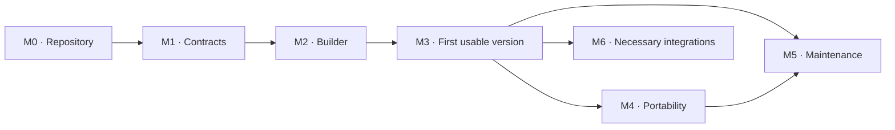

# Implementation roadmap

Updated: 2026-09-08. **Status: M0–M2 complete; M3–M6 pending.** Development in [afmanu/manu-control-center](https://github.com/afmanu/manu-control-center). Identifiers remain stable for architecture/component/acceptance traceability. [M2 evidence](m2-verification.json) and the [handoff](handoff.md) record current scope; historical [M0](m0-verification.json) and [M1](m1-verification.json) evidence is preserved.

## Intended delivery

Build a reusable product that creates and maintains AI knowledge and work systems, with **Manu as the first user**. The repository contains the builder/modules; each instance keeps configuration, knowledge and runs outside the distribution.

The first instance will ingest project information, retrieve context, distinguish decisions from proposals, produce sourced results and continue in another session. The [project knowledge and work](first-blueprint.md) blueprint supplies the initial path. Meeting → brief is the available reference case for implementation/testing, not an explicitly selected business priority attributed to Manu.

Start from the defined context. M0 is technical preparation and initial code, without another discovery interview. Make reversible choices during implementation and record them in [decisions.md](decisions.md).

## Deliverables and dependencies

| Phase | Concrete deliverable | Enables | Dependency |
|---|---|---|---|
| M0 — Executable repository | Package, minimal CLI, tests and technical decisions. | Install/run the development project. | Current documentation. |
| M1 — Contracts and persistence | Validated models, interfaces and tested reference store. | Store entities/state with identity, revisions and isolation. | M0. |
| M2 — Operational builder | Create, inspect, plan, apply, verify and adopt instances. | An installed, verifiable personal instance. | M1. |
| M3 — First usable version | Capture, search, context, workflows, real runtime and continuity. | Work with personal information from a fresh session. | M2. |
| M4 — Demonstrated portability | Another data representation and real runtime. | Move knowledge and continue work between compatible targets. | M3. |
| M5 — Maintenance and reproducible delivery | Updates, repair, auditing, documentation and installable package. | Sustained use and maintenance of other instances. | M3; full completion after M4. |
| M6 — Integrations and extensions | Real connections and additional capabilities by use case. | Applications/automation in everyday work. | M3 plus guarantees required by each extension. |

M3 delivers a usable local pilot; M5 completes maintainable, reproducible delivery. An integration essential for use may be brought forward from M3 as M6 work. Completing the entire extension catalog is unnecessary.

Order follows dependencies and verifiable outcomes. Do not assign dates before measuring initial development and effective runtime access. After M0, installation/test data can inform estimates for the next block without making estimation a prerequisite for progress.

## M0 — Executable repository

**Objective:** move from documentation to an installable, executable, testable project.

Work, in order:

1. **M0.1 · Local foundation.** Initialize local Git if absent, review data/secret exclusions, create the package and a minimal structure with useful files. Preserve specifications/background; resolve the remote and public distribution afterward.
2. **M0.2 · Technical decisions.** Select language, packaging, validation and storage with a small installation/conditional-write test. Record alternatives/consequences. Start with a modular local application, library and CLI; thirty responsibilities do not require thirty services.
3. **M0.3 · Pilot targets.** Choose a local record backend and the first invocable environment. Document how M4 will test a second document backend and runtime. An executable's presence does not establish product integration.
4. **M0.4 · Instance location.** Separate code, configuration and private data. The first deployment has one host responsible for jobs. Define durable-state location and export; folder synchronization does not coordinate writers.
5. **M0.5 · Development tools.** Add CLI help/version, test runner, a minimal executable contract and a guide with verified commands.

**Completion:** reproduce installation in a clean location, invoke the CLI and pass the minimal test. Decisions include versions and an actually observed target. Do not yet declare an operational instance.

**Delivery:** executable development repository with M1.1 ready to implement.

**Recorded completion:** M0.1–M0.5 implemented; 18 tests and clean installation passed. Git/MIT from the user's selected destination are preserved. The minimal package proves neither an instance backend nor an integrated runtime. See [development](development.md).

## M1 — Contracts and persistence

**Objective:** establish the common model and demonstrate guarantees needed by the builder/workflows.

1. **M1.1 · Construction.** Versioned schemas for need, blueprint, resolved specification, plan and manifest. Readable errors and validation of references, capabilities and ownership.
2. **M1.2 · Knowledge.** Project, source, capture, claim, decision, artifact and relation entities. Identity independent of names/paths; explicit provenance, revision, dates and access.
3. **M1.3 · Execution.** Skill, workflow, job, run, step, action and authorization contracts. Define transitions, budgets, cancellation, checkpoints and version compatibility.
4. **M1.4 · Persistence.** Minimal reference backend: create, read, query, update with expected revision and record relationships. Test isolation/exclusion before trusting it with operational state. State has one logical authority even if a document backend needs a complementary operational store.
5. **M1.5 · Difficult boundaries.** Specify effect identity across retries, rejection of the same key with different content, authorized decision promotion and per-operation time policy. Design export with executable definitions and authority transfer; implement in M4.
6. **M1.6 · Fixtures and harness.** Unify example formats, including open-question fields. Strictly separate executor-visible inputs from evaluator-only expectations. Add invalid cases, contradictory sources and a source without decisions.

**Completion:** exercise valid/invalid schemas; reject impossible transitions/stale revisions; verify isolation; keep `expected` out of executor input. Mechanism tests use deterministic expectations, separate from semantic evaluations.

**Delivery:** executable contracts, minimal store and backend/runtime/tool interfaces that do not import provider conventions into the core. Initial A27 completion; contractual foundation for A08, A10 and A21–A25.

**Recorded completion:** M1.1–M1.6 implemented: 22 contracts, coherent bundle, SQLite revisions/history/access, transitions/policies, effect identity, transfer contract and A27 harness. 74 tests and clean installation with package imports pass. A27 proves API separation; runtime workflows, leases and real effects remain M3/M4 work. See [M1 scope](m1-implementation.md) and [evidence](m1-verification.json).

## M2 — Operational builder

**Objective:** turn configuration into an installed, verifiable instance recoverable after failures.

1. **M2.1 · Resolve.** Initial catalog of one blueprint and required modules. Reuse existing context and request only essential missing fields. Resolve versions, capabilities and targets; example placeholders are not valid installations.
2. **M2.2 · Inspect and plan.** Discover existing resources and produce a plan without destination writes. Include preconditions, observed revisions, ownership, intended effects, verification and recovery.
3. **M2.3 · Apply.** Execute authorized operations with persistent checkpoints. Revalidate before writing. Reconcile resources already created before a crash; declare partial state where appropriate.
4. **M2.4 · Verify.** Manifest of actual installation and tested capabilities. Separate presence, configuration, invocation and functional outcome. Full workflow verification arrives in M3.
5. **M2.5 · Adopt.** Map an existing test project while preserving content/names. Distinguish managed, shared and user-owned resources; do not infer identity solely from names.
6. **M2.6 · Human entry point.** Real CLI operations to create/adopt, inspect, plan, apply and verify. Record errors/evidence with instance/operation IDs.

**Completion:** two isolated instances; planning without destination writes; stale plans rejected; interrupted/repeated application without duplicates; conservative adoption. A01, A02, A16 and A17 pass; A15/A19 pass for present capabilities.

**Delivery:** an installable, verifiable instance on the first backend. Automated creation is not yet proof of user work.

**Recorded completion:** M2.1–M2.6 implemented for `foundation`: pinned catalog/resolver, planning without destination writes, atomic resource/checkpoint application, durable verification and explicit adoption of MCC SQLite projects. CLI: resolve, plan, inspect, apply, verify, create, adopt and resume. A01/A02/A16/A17 pass on this target; A15/A19 cover present capabilities. 92 tests and clean package installation pass, including consumer-side creation/verification. Manu's local foundation has three resources; runtime integration remains pending. [Guide and limits](installation.md), [evidence](m2-verification.json).

## M3 — First version usable by Manu

**Objective:** complete useful work and preserve enough state to continue without conversation history.

1. **M3.1 · Capture and query.** Ingest initial-scope text/files, associate projects/sources, retain revisions and retrieve referenced context. Start with simple search; filter access before exposing content/results.
2. **M3.2 · Authority and time.** Distinguish facts, hypotheses, proposals and decisions. Extraction does not grant authority to activate a decision. Queries specify current/historical state; each run pins sources or requires freshness. Approved artifacts retain exact content.
3. **M3.3 · Useful work.** Implement `meeting-to-brief`: capture, retrieval, extraction, drafting, evaluation, review and completion. Add a small project-status summary path reusing the same modules to test that the core serves multiple workflows.
4. **M3.4 · Coordinator and effects.** One durable jobs/runs/actions state, atomic claims, revisions/fencing, recovery, budgets and cancellation. Controlled operations pass through the effect layer; stale processes cannot confirm new writes. Lost external responses retain uncertainty and reconcile before retry.
5. **M3.5 · Real runtime.** Implement the first adapter and run both workflows in it. Define which operations the product can technically control and how it supplies inputs, receives outputs and validates results. Agent instructions alone prove neither isolation nor tool control.
6. **M3.6 · Continuity and experience.** Provide a compatible-agent entry point and supporting CLI for capture, queries, execution, review and resumption. Generate handoff from persistent state with purpose, evidence, open items and next action. A new session must retrieve the project without reconstructing it through questions.
7. **M3.7 · First use.** Complete Manu's M2 foundation outside the repository with an editable operational profile and short guide. Verify synthetic material first and make explicit source ingestion available. External delivery stays simulated until the real M6 extension.

**Completion:** A03–A06, A08–A10, A18 and A20–A23 pass; A09 uses the identified simulator. A26 demonstrates both workflows and fresh-session continuity; A27 passes with the integrated evaluator. A15/A19 cover the added runtime/retrieval. Briefs invent no agreements, owners or dates and retain verifiable references.

**Delivery:** usable local pilot: install → add a source → query → run a workflow → review a result → resume another day. Includes real-runtime evidence, known limits and verified usage steps. Personal-data use does not imply migrating the entire vault.

## M4 — Demonstrated portability

**Objective:** prove the model works beyond its first implementation.

1. **M4.1 · Second representation.** Document adapter distinct from the record backend, with a shared entity/query/revision/access suite. Declare missing capabilities and resolve operational authority storage.
2. **M4.2 · Export and import.** Preserve IDs, relationships, provenance, required versions, exact artifacts and state. Include versioned skill/workflow/validator definitions or resolvable, verified references. Exclude credential values.
3. **M4.3 · Safe transfer.** Distinguish migration, copy and restore. Migration stops new source claims and transfers authority before destination execution. Copy remaps identity and leaves inherited pending jobs inactive. Restore checks the current executor. Reconcile uncertain actions and invalidate previous leases.
4. **M4.4 · Second runtime.** Execute the same contract in another real environment; interrupt work in the first and resume in the second after revalidating inputs, permissions, versions and effects.
5. **M4.5 · Compatibility matrix.** Record runtime/backend/version combinations, executed scenarios, evidence and limits. Test every declared supported combination; do not infer all combinations from one working pair.

**Completion:** A07, A12, A24 and A25 pass; A15/A19 pass in each declared combination. Accepted results/confirmed effects are not repeated. A missing dependency prevents the affected step from resuming with a readable error, without silent substitution.

**Delivery:** verified export/import and demonstrated continuity with two representations and two real runtimes. If a target is inaccessible, finish independent work and leave that compatibility pending.

## M5 — Maintenance and reproducible delivery

**Objective:** preserve work/customizations as the product evolves.

1. **M5.1 · Updates.** Compare previous managed version, observed state and new desired version. Preserve overrides, produce a change plan and detect conflicts. Pin, explicitly migrate or block open runs according to compatibility.
2. **M5.2 · Repair.** Diagnose partial installations, broken references, incompatibilities and blocked jobs. Apply bounded repairs with evidence; do not promise rollback of irreversible effects.
3. **M5.3 · Auditing and improvement.** Findings with stable IDs, history, state and evidence. Close only after a new check. Turn a detected problem into a concrete improvement and reevaluate the affected path.
4. **M5.4 · Usability quality.** Review pilot use: retrieved-context utility, required corrections, manual steps, timing and observable cost. Expand the semantic corpus from real failures; averages cannot hide permission/effect failures.
5. **M5.5 · Delivery.** Versioned packaging, automated tests, installation/use/backup/restore/update guides and support matrix. Install from scratch and update an earlier instance. Prepare a release candidate; resolve license, branding, remote and publication for distribution.

**Completion:** A11/A13 pass, with regression of the profile's mandatory scenarios and clean-install evidence. Restore/updates preserve data/artifacts; changing a defect's description does not resolve it.

**Delivery:** installable, maintainable product with a reproducible guide and declared coverage. Initial maintenance may start after M3; full completion includes M4 supported targets.

## M6 — Integrations and extensions as needed

**Objective:** add everyday-use capabilities on the tested core. Each extension is a bounded delivery.

| Block | Work | Completion condition |
|---|---|---|
| M6.1 · Real applications and sources | Connect necessary pilot applications; read, write or deliver according to capability/scope. | Real access tested, errors/disconnections covered, effect receipts or reconciliation. Real A09 and A10/A18/A19 as applicable. |
| M6.2 · Recurrence | Triggers/scheduler creating jobs in the same coordinator. | A14 passes with timezone, repeated events, disconnection, recovery and cancellation. |
| M6.3 · Additional interface | Project, run, artifact, open-item and review views if CLI/agent are insufficient. | User completes the path; UI reads/writes through existing contracts without another state authority. |
| M6.4 · Remote access and delegation | Gateway or multiple executors when needed. | Authentication/scope, exclusion, fencing, disconnection and observability tested in real deployment. |
| M6.5 · More blueprints and capabilities | Other processes, skills and targets reusing the core. | Versioned contracts, dependencies, evals and compatibility; no regressions in existing capabilities. |

First resolve needs preventing pilot use, then reduce observed manual work. Do not connect every available application or make optional modules installation prerequisites. M6.1 can start after M3; content publication/communications require corresponding authorization scope.

## Acceptance traceability

Full cases live in [acceptance.md](acceptance.md). This table assigns the first functional gate; rerun cases when their surface expands or mechanism changes.

| Gate | Scenarios |
|---|---|
| M0 | Installation, CLI and minimal contract test. |
| M1 | A27: input/expectation separation. Contract/persistence unit tests. |
| M2 | A01, A02, A16, A17; A15/A19 for constructor and initial backend. |
| M3 | A03, A04, A05, A06, A08, simulated A09, A10, A18, A20, A21, A22, A23, A26; expand A15/A19/A27. |
| M4 | A07, A12, A24, A25; expand A15/A19 to supported targets. |
| M5 | A11, A13; profile regression and installation/update/restore. |
| M6 | Real A09, A14 if recurrent, and scenarios affected by each extension. |

Analysis findings are embedded in concrete tasks: effect identity (M1.5/M3.4), runtime mediation (M3.5), decision authority (M3.2), time policy (M3.2), active-job migration/executable dependencies (M4.2–M4.3), fixture normalization/isolation (M1.6), incremental component coverage and usefulness beyond one path (M3.3/M5.4).

## Execution and completion rules

Add code when it has useful behavior: `core` defines contracts; `builder`, `lifecycle` and `execution` consume them; adapters implement interfaces; skills/workflows compose capabilities. `tests` checks mechanisms; `evals` checks outcomes. Provider details remain in their adapters.

Each completion updates [handoff.md](handoff.md) with version/commit if available, completed tasks, actual commands, results, evidence, limits, decisions and next task. A phase may be pending, in progress, partially verified or complete. Completion requires all applicable criteria to pass; a simulation never proves a real integration.

**Next development action: M3.1.** Add local-source capture and provenance-aware queries on the existing backend. Continue with temporal authority, both workflows, coordination, real runtime and foundation-instance use; preserve its data and document required configuration evolution. The intervening English-repository update is recorded in D24 and does not start M3.

[Home](../README.md)
