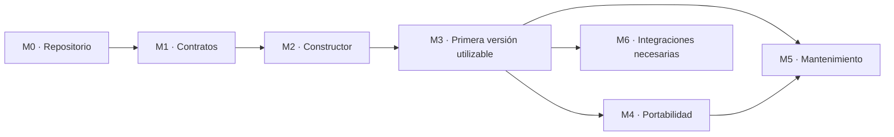

# Roadmap de implementación

Actualizado: 2026-09-08. **Estado: M0–M2 completados; M3–M6 pendientes.** Desarrollo en [afmanu/manu-control-center](https://github.com/afmanu/manu-control-center). Este plan conserva sus identificadores para mantener la trazabilidad con arquitectura, componentes y aceptación. La [evidencia de M2](m2-verification.json) y el [handoff](handoff.md) registran el alcance actual; se conservan las evidencias históricas de [M0](m0-verification.json) y [M1](m1-verification.json).

## Resultado que vamos a entregar

Construir un producto reutilizable que cree y mantenga sistemas de conocimiento y trabajo con IA, con **Manu como primer usuario**. El repositorio contiene el constructor y sus módulos; cada instancia conserva su configuración, conocimiento y ejecuciones fuera de la distribución.

La primera instancia permitirá incorporar información de un proyecto, recuperar su contexto, distinguir decisiones de propuestas, producir un resultado con fuentes y continuar en otra sesión. El blueprint [conocimiento y trabajo sobre un proyecto](first-blueprint.md) proporciona el recorrido inicial. Reunión → brief es el caso de referencia disponible para implementarlo y probarlo; no se presenta como una prioridad de negocio que Manu haya elegido expresamente.

Partimos del contexto ya definido. M0 es preparación técnica y comienzo del código, sin una nueva entrevista de descubrimiento. Las decisiones reversibles se toman durante la implementación y se registran en [decisions.md](decisions.md).

## Entregas y dependencias

| Fase | Entrega concreta | Qué permite | Dependencia |
|---|---|---|---|
| M0 — Repositorio ejecutable | Paquete, CLI mínima, pruebas y decisiones técnicas. | Instalar y ejecutar el proyecto en desarrollo. | Documentación actual. |
| M1 — Contratos y persistencia | Modelos validados, interfaces y almacén de referencia probado. | Guardar entidades y estado con identidad, revisiones y aislamiento. | M0. |
| M2 — Constructor operativo | Crear, inspeccionar, planificar, aplicar, verificar y adoptar instancias. | Disponer de una instancia propia instalada y verificable. | M1. |
| M3 — Primera versión utilizable | Captura, búsqueda, contexto, workflows, runtime real y continuidad. | Trabajar con información propia desde una sesión nueva. | M2. |
| M4 — Portabilidad demostrada | Otra representación de datos y otro runtime real. | Mover conocimiento y continuar trabajos entre destinos compatibles. | M3. |
| M5 — Mantenimiento y entrega reproducible | Actualización, reparación, auditoría, documentación y paquete instalable. | Usarlo de forma continuada y mantener otras instancias. | M3; cierre completo tras M4. |
| M6 — Integraciones y ampliaciones | Conexiones reales y capacidades adicionales por caso de uso. | Incorporar aplicaciones y automatización al trabajo diario. | M3 más las garantías que requiera cada extensión. |

M3 entrega el piloto local utilizable; M5 cierra la entrega mantenible y reproducible. Una integración imprescindible para usarlo puede adelantarse desde M3 como trabajo de M6. No es necesario esperar a completar todo el catálogo de extensiones.

El orden se fija por dependencias y resultados verificables. No se asignan fechas sin medir el primer desarrollo y el acceso efectivo a los runtimes. Tras M0 se podrá estimar el siguiente bloque con datos de instalación y pruebas, sin convertir esa estimación en requisito para avanzar.

## M0 — Repositorio ejecutable

**Objetivo:** pasar de documentación a un proyecto que se puede instalar, ejecutar y comprobar.

Trabajo, en orden:

1. **M0.1 · Base local.** Inicializar Git local si no existe, revisar exclusiones de datos y secretos, crear el paquete y una estructura mínima con archivos útiles. Conservar las especificaciones y los antecedentes; el remoto y la distribución pública se resuelven después.
2. **M0.2 · Decisiones técnicas.** Seleccionar lenguaje, empaquetado, validación y almacenamiento con una prueba pequeña de instalación y escritura condicional. Registrar alternativas y consecuencias. La forma inicial será una aplicación local modular con biblioteca y CLI; las treinta responsabilidades no requieren treinta servicios.
3. **M0.3 · Destinos del piloto.** Elegir un backend local de registros y el primer entorno invocable. Documentar cómo se comprobará un segundo backend documental y otro runtime en M4. La presencia de un ejecutable no acredita integración del producto.
4. **M0.4 · Ubicación de la instancia.** Separar código, configuración y datos privados. El primer despliegue tendrá un host responsable de ejecutar trabajos. Definir la ubicación del estado durable y la exportación; no atribuir coordinación de escritores a la sincronización de una carpeta.
5. **M0.5 · Herramientas de desarrollo.** Añadir CLI con ayuda y versión, runner de pruebas, un contrato mínimo ejecutable y guía con comandos comprobados.

**Cierre:** instalación reproducida en una ubicación limpia, CLI invocable y prueba mínima aprobada. Las decisiones incluyen versiones y destino real observado. Todavía no se declara una instancia operativa.

**Entrega:** repositorio de desarrollo ejecutable y siguiente tarea M1.1 lista para implementar.

**Cierre registrado:** M0.1–M0.5 implementados; 18 tests y prueba de instalación limpia aprobados. Se conservan Git y MIT del destino indicado por el usuario. El paquete mínimo no acredita un backend de instancia ni un runtime integrado. Véase [desarrollo](development.md).

## M1 — Contratos y persistencia

**Objetivo:** establecer el modelo común y demostrar las garantías que utilizarán el constructor y los workflows.

1. **M1.1 · Construcción.** Esquemas versionados de necesidad, blueprint, especificación resuelta, plan y manifiesto. Errores legibles y validación de referencias, capacidades y ownership.
2. **M1.2 · Conocimiento.** Entidades de proyecto, fuente, captura, afirmación, decisión, artefacto y relación. Identidad independiente del nombre o ruta; procedencia, revisión, fechas y acceso explícitos.
3. **M1.3 · Ejecución.** Contratos de skill, workflow, job, run, step, action y autorización. Definir transiciones, presupuestos, cancelación, checkpoints y compatibilidad de versiones.
4. **M1.4 · Persistencia.** Implementación mínima del backend de referencia: crear, leer, consultar, actualizar con revisión esperada y registrar relaciones. Probar aislamiento y exclusión antes de confiarle estado operativo. El estado tiene una autoridad lógica aunque un backend documental requiera un almacén operativo complementario.
5. **M1.5 · Fronteras difíciles.** Precisar identidad de un efecto entre reintentos, rechazo de la misma clave con contenido distinto, promoción autorizada de decisiones y política temporal por operación. Diseñar exportación con definiciones ejecutables y transferencia de autoridad; implementarla en M4.
6. **M1.6 · Fixtures y harness.** Unificar formatos de los ejemplos, incluidos los campos de preguntas abiertas. Separar estrictamente entradas visibles por el ejecutor y expectativas reservadas al evaluador. Añadir casos inválidos, fuentes contradictorias y fuente sin decisiones.

**Cierre:** esquemas válidos e inválidos ejercitados; transiciones imposibles y revisiones obsoletas rechazadas; aislamiento comprobado; el ejecutor de evaluación no recibe `expected`. Las pruebas de mecanismo usan expectativas deterministas, separadas de las evaluaciones semánticas.

**Entrega:** contratos ejecutables, almacén mínimo e interfaces de backend/runtime/herramientas que no importan convenciones de un proveedor al núcleo. Primer cierre de A27; base contractual de A08, A10 y A21–A25.

**Cierre registrado:** M1.1–M1.6 implementados: 22 contratos, bundle coherente, backend SQLite con revisiones/historial/acceso, transiciones y políticas, identidad de efectos, contrato de traslado y harness A27. Pasan 74 tests e instalación limpia con imports del paquete. La prueba de A27 cubre separación de API; los recorridos con runtime, leases y efectos reales siguen en M3/M4. Véanse [alcance M1](m1-implementation.md) y [evidencia](m1-verification.json).

## M2 — Constructor operativo

**Objetivo:** convertir una configuración en una instancia instalada, verificable y recuperable tras fallos.

1. **M2.1 · Resolver.** Catálogo inicial de un blueprint y los módulos necesarios. Reutilizar los datos de contexto existentes y pedir solamente campos imprescindibles que falten. Resolver versiones, capacidades y destinos; los placeholders de los ejemplos no son instalaciones válidas.
2. **M2.2 · Inspeccionar y planificar.** Descubrir recursos existentes y producir un plan sin escrituras en el destino. Incluir precondiciones, revisiones observadas, ownership, efectos previstos, verificación y recuperación.
3. **M2.3 · Aplicar.** Ejecutar operaciones autorizadas con checkpoints persistentes. Revalidar el destino antes de escribir. Reconciliar recursos ya creados tras una caída; declarar estado parcial cuando corresponda.
4. **M2.4 · Verificar.** Manifiesto de lo efectivamente instalado y reporte de capacidades probadas. Separar presencia, configuración, invocación y resultado funcional. El workflow completo se verificará en M3.
5. **M2.5 · Adoptar.** Mapear un proyecto preexistente de prueba conservando contenido y nombres. Diferenciar recursos gestionados, compartidos y del usuario; no inferir identidad solo por nombre.
6. **M2.6 · Entrada humana.** Operaciones reales de CLI para crear/adoptar, inspeccionar, planificar, aplicar y verificar. Registrar errores y evidencia con IDs de instancia y operación.

**Cierre:** dos instancias aisladas; planificación sin escrituras en el destino; plan obsoleto rechazado; aplicación interrumpida y repetida sin duplicados; adopción conservadora. A01, A02, A16 y A17 pasan; A15 y A19 pasan para las capacidades presentes.

**Entrega:** una instancia instalable y verificable con el primer backend. La creación automática no se confunde con haber probado todavía el trabajo de usuario.

**Cierre registrado:** M2.1–M2.6 implementados para el perfil `foundation`: catálogo y resolver con versiones fijadas, planificación sin escrituras en destino, aplicación con recurso/checkpoint atómicos, verificación durable y adopción explícita de proyectos MCC SQLite. CLI disponible: resolve, plan, inspect, apply, verify, create, adopt y resume. A01/A02/A16/A17 pasan en este destino; A15/A19 cubren las capacidades presentes. Pasan 92 tests e instalación limpia del paquete, incluida creación y verificación desde el consumidor. Se ha preparado la base local de Manu con tres recursos; la integración del runtime permanece pendiente. [Guía y límites](installation.md), [evidencia](m2-verification.json).

## M3 — Primera versión utilizable por Manu

**Objetivo:** completar trabajo útil y conservar suficiente estado para continuar sin el historial de la conversación.

1. **M3.1 · Captura y consulta.** Ingresar texto o archivos del alcance inicial, asociarlos a proyectos y fuentes, conservar revisiones y recuperar contexto con referencias. Búsqueda inicial sencilla; filtros de acceso antes de exponer contenido o resultados.
2. **M3.2 · Autoridad y tiempo.** Diferenciar hechos, hipótesis, propuestas y decisiones. Una extracción no concede autoridad para hacer vigente una decisión. Las consultas indican si buscan estado actual o histórico; cada ejecución define si fija sus fuentes o exige frescura. Los artefactos aprobados conservan su contenido exacto.
3. **M3.3 · Trabajo útil.** Implementar `meeting-to-brief`: captura, recuperación, extracción, borrador, evaluación, revisión y cierre. Añadir un recorrido pequeño de resumen de estado del proyecto que reutilice los mismos módulos. Así comprobamos que el núcleo sirve para más de un flujo.
4. **M3.4 · Coordinador y efectos.** Estado durable único de jobs/runs/acciones, reclamación atómica, revisiones y fencing, recuperación, presupuestos y cancelación. Las operaciones controladas pasan por la capa de efectos; un proceso obsoleto no puede confirmar nuevas escrituras. Para respuestas externas perdidas, conservar incertidumbre y reconciliar antes de reintentar.
5. **M3.5 · Runtime real.** Implementar el primer adaptador y ejecutar ambos recorridos con ese entorno. Delimitar qué operaciones puede controlar técnicamente el producto y cómo entrega entradas, recibe salidas y valida resultados. Las instrucciones de un agente por sí solas no prueban aislamiento ni control de herramientas.
6. **M3.6 · Continuidad y experiencia.** Entregar entrada desde el agente compatible y CLI de apoyo para capturar, consultar, ejecutar, revisar y reanudar. El handoff deriva del estado persistente e incluye propósito, evidencia, pendientes y siguiente acción. Una sesión nueva debe recuperar el proyecto sin reconstruirlo mediante preguntas.
7. **M3.7 · Puesta en uso.** Completar la instancia base de Manu preparada en M2, separada del repositorio, con perfil operativo editable y guía breve. Verificarla primero con material sintético y dejar disponible la incorporación explícita de sus fuentes. El conector de entrega externa se mantiene simulado hasta la extensión real de M6.

**Cierre:** A03–A06, A08–A10, A18 y A20–A23 pasan; A09 utiliza el simulador identificado. A26 demuestra los dos recorridos y continuidad en una sesión nueva; A27 sigue pasando con el evaluador integrado. A15/A19 cubren el runtime y recuperación incorporados. El brief no inventa acuerdos, responsables ni fechas, y conserva referencias verificables.

**Entrega:** piloto local utilizable: instalar → incorporar una fuente → consultar → ejecutar un workflow → revisar un resultado → retomar otro día. Incluye evidencia de un runtime real, límites conocidos y pasos de uso comprobados. El uso de datos propios no implica migrar todo el vault.

## M4 — Portabilidad demostrada

**Objetivo:** comprobar que el modelo funciona fuera de su primera implementación.

1. **M4.1 · Segunda representación.** Adaptador documental distinto del backend de registros, con suite común de entidades, consultas, revisiones y acceso. Declarar capacidades faltantes y resolver dónde vive la autoridad operativa.
2. **M4.2 · Exportar e importar.** Preservar IDs, relaciones, procedencia, versiones requeridas, artefactos exactos y estado. Incluir las definiciones versionadas de skills, workflows y validadores, o referencias que se resuelvan y verifiquen. Excluir valores de credenciales.
3. **M4.3 · Traslado seguro.** Distinguir migración, copia y restauración. En migración, detener nuevas reclamaciones en el origen y transferir autoridad antes de ejecutar en destino. En copia, remapear identidad y mantener trabajos pendientes inactivos. En restauración, comprobar cuál es el ejecutor vigente. Reconciliar acciones inciertas e invalidar leases anteriores.
4. **M4.4 · Segundo runtime.** Ejecutar el mismo contrato en otro entorno real; interrumpir trabajo en el primero y reanudarlo en el segundo con revalidación de entradas, permisos, versiones y efectos.
5. **M4.5 · Matriz de compatibilidad.** Registrar combinación de runtime/backend/versiones, escenarios ejecutados, evidencias y límites. Probar las combinaciones que se declaren soportadas; no inferir todas a partir de una pareja que funciona.

**Cierre:** A07, A12, A24 y A25 pasan; A15 y A19 pasan en cada combinación declarada. Los resultados aceptados y efectos confirmados no se repiten. Una dependencia ausente impide reanudar el paso afectado con un error legible, sin sustituirla silenciosamente.

**Entrega:** exportación e importación verificadas y continuidad demostrada con dos representaciones y dos runtimes reales. Si falta acceso a un destino, se completa lo independiente y su compatibilidad permanece pendiente.

## M5 — Mantenimiento y entrega reproducible

**Objetivo:** conservar el trabajo y las personalizaciones mientras el producto evoluciona.

1. **M5.1 · Actualización.** Comparar versión gestionada anterior, estado observado y nueva versión deseada. Preservar overrides, producir plan de cambio y detectar conflictos. Fijar, migrar explícitamente o bloquear runs abiertos según compatibilidad.
2. **M5.2 · Reparación.** Diagnóstico de instalación parcial, referencias rotas, incompatibilidades y trabajos bloqueados. Reparación acotada con evidencia; no prometer rollback de efectos irreversibles.
3. **M5.3 · Auditoría y mejora.** Hallazgos con IDs estables, historial, estado y evidencia. Cerrar solo después de una comprobación nueva. Convertir un problema detectado en una mejora concreta y volver a evaluar el recorrido afectado.
4. **M5.4 · Calidad de uso.** Revisar el uso del piloto: utilidad del contexto recuperado, correcciones necesarias, pasos manuales, tiempos y coste observable. Ampliar el corpus semántico según fallos reales, sin usar una puntuación media para ocultar fallos de permisos o efectos.
5. **M5.5 · Entrega.** Empaquetado versionado, pruebas automatizadas, guía de instalación/uso/backup/restauración/actualización y matriz de soporte. Instalar desde cero y actualizar una instancia de la versión anterior. Preparar un candidato a release; licencia, marca, remoto y publicación se resuelven al distribuir.

**Cierre:** A11 y A13 pasan, con regresión de los escenarios obligatorios para el perfil y evidencia de instalación limpia. La restauración y actualización preservan datos y artefactos; los defectos relevantes no se marcan resueltos por cambiar solamente su descripción.

**Entrega:** producto instalable y mantenible, con guía reproducible y cobertura declarada. El primer trabajo de mantenimiento puede empezar tras M3; su cierre incluye los destinos soportados de M4.

## M6 — Integraciones y ampliaciones por necesidad

**Objetivo:** incorporar lo que necesite el uso diario sobre el núcleo ya probado. Cada extensión es una entrega acotada.

| Bloque | Trabajo | Condición de cierre |
|---|---|---|
| M6.1 · Aplicaciones y fuentes reales | Conectar las aplicaciones necesarias del piloto; lectura, escritura o entrega según capacidades y alcance. | Acceso real probado, errores/desconexión cubiertos y recibos o reconciliación de efectos. A09 real y A10/A18/A19 según el conector. |
| M6.2 · Recurrencia | Triggers y scheduler que crean jobs del mismo coordinador. | A14 pasa con zona horaria, eventos repetidos, desconexión, recuperación y cancelación. |
| M6.3 · Interfaz adicional | Vista de proyectos, ejecuciones, artefactos, pendientes y revisión, si la CLI y el agente resultan insuficientes. | El usuario completa el recorrido; la UI lee/escribe mediante contratos existentes y no crea otra autoridad de estado. |
| M6.4 · Acceso remoto y delegación | Gateway o varios ejecutores cuando el caso los requiera. | Autenticación y alcance, exclusión, fencing, desconexión y observabilidad probados en el despliegue real. |
| M6.5 · Más blueprints y capacidades | Otros procesos, skills y destinos reutilizando el núcleo. | Contratos, dependencias, evals y compatibilidad versionados; la nueva capacidad no rompe las existentes. |

Prioridad: resolver primero una necesidad que impida el uso del piloto; después reducir trabajo manual observado. No conectar todas las aplicaciones por disponibilidad ni convertir los módulos opcionales en requisitos de instalación. M6.1 puede comenzar tras M3; publicación de contenido y comunicaciones requieren el alcance de autorización correspondiente.

## Trazabilidad de aceptación

Los casos completos viven en [acceptance.md](acceptance.md). Esta tabla asigna la primera puerta funcional; los casos se vuelven a ejecutar cuando se amplía su superficie o cambia su mecanismo.

| Puerta | Escenarios |
|---|---|
| M0 | Instalación, CLI y prueba mínima de contrato. |
| M1 | A27: separación entre entradas y expectativas. Pruebas unitarias de contratos y persistencia. |
| M2 | A01, A02, A16, A17; A15/A19 para constructor y backend inicial. |
| M3 | A03, A04, A05, A06, A08, A09 simulado, A10, A18, A20, A21, A22, A23, A26; ampliar A15/A19/A27. |
| M4 | A07, A12, A24, A25; ampliar A15/A19 a los destinos soportados. |
| M5 | A11, A13; regresión del perfil e instalación/actualización/restauración. |
| M6 | A09 real, A14 si recurrente y escenarios afectados por cada extensión. |

Los hallazgos del análisis quedan incorporados en tareas concretas: identidad de efectos (M1.5/M3.4), mediación del runtime (M3.5), autoridad de decisiones (M3.2), política temporal (M3.2), migración de trabajos activos y dependencias ejecutables (M4.2–M4.3), normalización y aislamiento de fixtures (M1.6), cobertura incremental de componentes y utilidad de más de un recorrido (M3.3/M5.4).

## Reglas de ejecución y cierre

El código se incorpora cuando tiene comportamiento útil: `core` define contratos; `builder`, `lifecycle` y `execution` los consumen; los adaptadores implementan las interfaces; skills y workflows componen capacidades. `tests` comprueba mecanismos y `evals` resultados. Los detalles de un proveedor permanecen en su adaptador.

Cada cierre actualiza [handoff.md](handoff.md) con versión/commit si existe, tareas realizadas, comandos reales, resultados, evidencia, limitaciones, decisiones y próxima tarea. Una fase puede estar pendiente, en curso, parcialmente verificada o completada. Solo se completa si pasan sus criterios aplicables; una simulación nunca acredita una integración real.

**Siguiente acción de desarrollo: M3.1.** Añadir captura de fuentes locales y consultas con procedencia sobre el backend existente. Continuar con autoridad temporal, los dos workflows, coordinación, runtime real y uso de la instancia base; conservar sus datos y documentar cualquier evolución de configuración necesaria.

[Entrada](../README.md)
