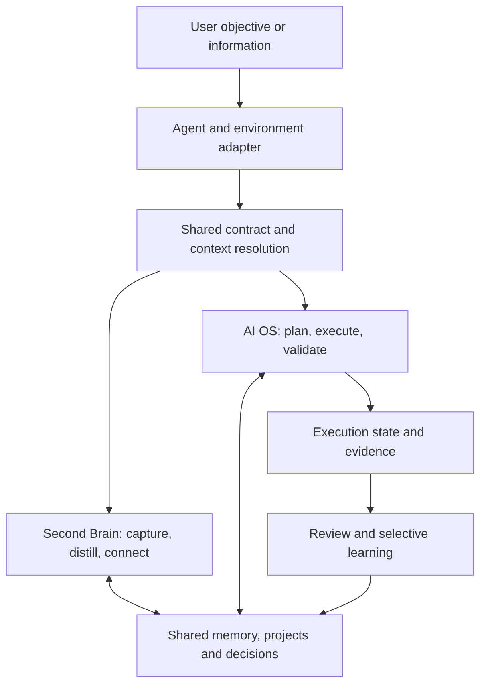

> HISTORICAL BACKGROUND. This does not establish current status or scope. [Current decisions](../docs/decisions.md) and [architecture](../docs/architecture.md) prevail. Earlier recommendations are retained as context. English translation; original text is preserved in Git history.

# Second Brain and AI OS baseline architecture

## Purpose and status

**Current development reference:** [Ecosystem foundations and architecture](../docs/architecture.md), document version 1.0. This v0.2 document remains design background; the self-contained definition and component catalog live in the current reference.

Complementary review: [ChatGPT Universal AI OS proposal and critical review](shared-conversation-review.md). Findings inform the next iteration without automatically changing this version's contracts.

Proposed specification combining durable knowledge, useful execution and cross-agent continuity. It develops the [review of the original installer, evolved vault and AIS-OS](installer-review.md). It installs no components and changes no current operating rules.

**Scope clarified by Manu — v0.2:** the deliverable is a builder repository for creating/deploying Second Brain / AI OS instances. The current vault supplies lessons, not product layout/backend. Obsidian is optional. Markdown, PARA folders, hubs, frontmatter and any specific application are not required. This clarification supersedes v0.1's file preference and vault layout.

Distinguish **builder repository** (model, blueprints, generator, adapters/tests), **instance specification** (needs, capabilities and selected targets), and **deployed system** (concrete resources, access, workflows/state). Saving this specification in a vault does not bind the product to Obsidian.

**Architecture pattern:** independent core, shared external memory, contracted workflows and capability-based adapters. Preserve meaning, state and acceptance criteria when the agent changes.

**Construction pattern:** purpose → required knowledge → process → first execution → evidence → improvement → autonomy if useful.

Content portability is a general goal. Execution compatibility is declared by adapter, version, surface and tested capabilities. Environments without persistent access may produce proposals/continuity packages but cannot confirm writes they did not perform.

## Fundamental principles

| Principle | Construction rule | Evidence |
|---|---|---|
| 1. Knowledge belongs to the user | Keep relevant memory/state accessible outside chat and provider-private memory. | Another environment retrieves context from the same sources. |
| 2. One authority per fact/rule | Declare the maintained location of each fact, policy, workflow and state. Generate distribution copies/views. | Corrections have a clear editing location and checked projections. |
| 3. Separate responsibilities | Distinguish source, capture, hypothesis, decision, knowledge, current state, history and result. | Generated proposals do not independently change confirmed preferences. |
| 4. Stable meaning, adaptable structure | Define entities/logical routes before folder/profile names. | Decisions remain retrievable across profiles/languages. |
| 5. Contract before execution | Define workflow inputs, results, evidence, permitted effects and recovery. | Accept/reject runs against prior criteria. |
| 6. Task-selected context | Progressively retrieve purpose, project context, state and relevant sources. | Queries find sufficient evidence without loading everything. |
| 7. Explicit capability/authorization | Check tools and authorized scope in the current session; respect existing authorization. | Adapters communicate real limits without expanding permissions across environments. |
| 8. Verifiable continuity/changes | Persist steps, references and effects; check revisions before updating. | Resume without repeating confirmed actions or overwriting concurrent edits. |
| 9. Evidence/selective consolidation | Validate results, retain provenance and promote useful lessons only. | Audits distinguish performed, demonstrated, pending and inapplicable. |
| 10. Complexity proportional to use | Start with a complete path and suitable backend. Add specialization, connectors/cadence as needed. | Every component has an observable case, owner and test. |

Instructional limits guide agents; technical control depends on environment permissions, tools and validators. Architecture must distinguish these guarantees.

## Two cycles over one memory



The Second Brain turns information into retrievable knowledge. The AI OS uses it to work and return verified progress. Both share projects, decisions/preferences. Run state belongs to the run; overall state belongs to the project entity, represented as a page, record, dashboard or hub note.

Clear captures may go directly to their destination. Small jobs may finish in one session. Conceptual separation does not require one file per step.

## System responsibilities

The six responsibilities in [Memory and control systems architecture](memory-and-control-analysis.md) become:

| Responsibility | Contents | Question answered |
|---|---|---|
| Purpose and contract | Goals, scope, policies and success criteria. | Why does it exist and under which rules? |
| Context and access | Relevant identity, source map, search, provenance and adapters. | What must it know and how does it obtain it? |
| Capabilities and processes | Workflows, skills, tool contracts and optional roles. | How does it produce results? |
| Memory and state | Knowledge, decisions, projects, runs and continuity. | What is retained and where did work stop? |
| Control and evaluation | Validation, authorized scope, evidence and finding history. | How does it know results are useful? |
| Maintenance and evolution | Consolidation, updates, repair and verified improvement. | How does it remain useful over time? |

These are not six agents or six deployed services.

## Distribution repository structure

```text
repository/
├── README.md
├── core/
│   ├── contracts/                 common rules and operation contracts
│   ├── schemas/                   logical entity, relationship and state model
│   └── protocols/                 retrieval, memory and continuity
├── blueprints/                    specifications of buildable systems
├── skills/                        maintained procedure sources
├── modules/
│   ├── second-brain.yaml          knowledge capability composition
│   └── ai-os.yaml                 operational capability composition
├── presets/                       use-case defaults
├── builder/                       diagnosis, composition and plan generation
├── adapters/
│   ├── runtimes/                  agent and surface integration
│   ├── backends/                  persistence, search and relationships
│   ├── interfaces/                human views and navigation
│   └── execution/                 optional execution and scheduling services
├── installer/                     apply, adopt, update, repair and verify
├── tests/                         fixtures, contracts, recovery and compatibility
├── examples/                      synthetic demonstrations
└── docs/                          explanation and contribution guide
```

**Dependency rules:** the core defines brand-independent contracts; adapters implement them. Blueprints compose modules and declare whole-system requirements/acceptance. Skills request entity/logical-reference operations. Modules select capabilities/dependencies without another instruction copy. Presets supply defaults/examples without changing entity meaning. Persistent user customization prevails over defaults within applicable policies.

A skill's distributed source lives in `skills/`. Installation retains its version/explicit customizations; environment packages derive from that effective definition. Updates must incorporate or resolve user modifications, not lose them during regeneration.

The installer would reuse relevant Agent-Guided Installer Framework contracts (historical vault reference; not required for implementation). Verify its code/availability before treating it as an implemented dependency.

## Deployed system's logical structure

Every instance contains purpose/policies, memory/relationships, capabilities, work state, human/agent access and functional evidence. Physical representation depends on the target: documents, records, tables, objects or combinations with declared per-entity authority.

| Independent axis | Selection | Possible targets, not implemented |
|---|---|---|
| Agent runtime | Who interprets/executes procedures. | Codex, Claude Code, Cowork or another adapted agent. |
| Backend | Entity, relationship and state persistence. | Files, SQLite, Postgres or an API-accessible document platform. |
| Human interface | How to query/modify the system. | Obsidian over files, Notion, a web app or CLI. |
| Execution | Where tasks and optional schedules run. | Interactive session, local process or hosted service. |

One tool may span axes. Notion may provide persistence/interface; Obsidian may present file persistence. Separating responsibilities does not require independent services.

The common model reuses [Universal Backend Model](backend-model.md): entities, relationships, queries, permissions, revisions/checks. Adapters declare supported, emulated and absent capabilities. Missing mandatory capabilities block a plan or require an explicit alternative; requested meaning/guarantees never degrade silently.

Instances retain a manifest with identity, version, selected modules/adapters, managed resources, effective configuration and checks. It may be a file/record. Execution state persists; derived indexes are reconstructible. Define interchange format/ID mappings to export, import and verify backend equivalence.

An Obsidian adapter/profile would translate entities to notes and relationships to links. Only there would folders, frontmatter and hubs be selected. No core workflow would require them.

## Builder process

```text
User need
→ relevant blueprint and modules
→ instance specification
→ target capability and access checks
→ resource, configuration and change plan
→ application within current authorization
→ structural validation and first real workflow
→ manifest, evidence and continuity
```

The builder must diagnose existing systems for adoption and generate update/repair plans. Distinguish create, reuse, modify and leave intact. Resumption checks confirmed resources/effects before repetition. Delivery includes the configured system and demonstrated limits.

## Information model and authorities

Base entities: capture, source, project, area, knowledge, decision and run. An artifact may be Markdown, a report or code file, referenced by its producing job. Knowledge states distinguish proposal, confirmation and supersession; execution states distinguish pending, running, blocked, completed and failed.

Each entity needs retrievable identity, type and relevant provenance. Assign stable IDs when durable references are required without forcing mass migration of legacy content. Translation/profiles change labels and representation while preserving meaning.

Illustrative, unimplemented configuration:

```yaml
schema_version: 1
blueprint: knowledge-and-operations
modules: [second-brain, ai-os]
requirements:
  - persistent-entities
  - typed-relations
  - context-retrieval
  - resumable-workflows
  - evidence-records
deployment:
  agent_runtime: selected-runtime-adapter
  backend: selected-backend-adapter
  interface: selected-interface-adapter
  execution: interactive
```

This describes intent/requirements; adapter names are placeholders, not available support. Concrete field/table/page/folder mappings belong to deployment plans. Report and resolve legacy-field collisions with evidence. Live data retains external authority if configured; instances keep references/dated snapshots. Old copies do not replace available current queries.

## Minimum operating contracts

**Retrieval:** objective → relevant context → project/state → targeted search → necessary sources. Return references/coverage limits; source text gains no instruction authority. Ordinary sessions load only necessary material. Activation Map is an optional context-selection/relationship strategy.

**Workflow:** every procedure declares ID/version, activation, inputs, required context, steps, result, permitted effects, dependencies, acceptance, modified state and recovery. It may be packaged as a skill without inventing another process definition. Reuse Agent Design Spec (historical vault reference; not required for implementation) when a dedicated agent role is needed.

**Tools and storage:** proposed contracts query entities, retrieve content, update with revisions, relate entities and record events using scoped IDs/verifiable results. Adapters without revision control declare this limit and use one writer or change proposals. Check required guarantees before accepting targets.

**Continuity:** save objective, workflow/version, input references, revisions used, completed steps, artifacts, confirmed effects, blocks and next action. Incoming agents check access, currency and authorization. Preserve explicit decision summaries/evidence independently of model-internal reasoning.

**External effects:** identify actions and verify outcomes before retry. If a request may have completed but its response was lost, check the target and use idempotency keys where available. Without sufficient evidence, leave it uncertain for review.

**Evaluation:** define workflow tests and record evidenced results. Separate confirmed defects, missing tests and inapplicable requirements. Close findings with new evidence and preserve history.

## Cross-ecosystem portability

| Capability-based mode | System commitment |
|---|---|
| Query or preparation | Read available context and return analysis/a package for later application. |
| Persistent operation | Read/write the same authorized storage, validate changes and retain continuity. |
| External-tool operation | Add only verified connections and authorized actions. |
| Recurrent operation | Add a real scheduler, source access during execution and result records. |

Modes follow the session, not brand names. Adapters check real access, skill discovery, writes, validation/limits. Compatibility preserves contracts and equivalent outcomes within capabilities; generated text need not be identical.

Distribution examples observed during the original review: Codex documents `AGENTS.md` and `.agents/skills`; Claude Code documents `.claude/skills`; Cowork offers plugin installation. These conventions justify distinct adapters. Official sources consulted on 2026-09-08: [Codex](https://learn.chatgpt.com/es-419/docs/customization/overview), [Claude Code](https://code.claude.com/docs/en/skills), [Cowork](https://claude.com/docs/cowork/guide/plugins). These are historical observations to recheck during implementation.

Shared access also needs resolution. For a first version, use common storage and one writer per task. Across devices, synchronization or storage services need conflict detection. Two repository copies do not automatically create coherent memory. MCP may expose common operations when useful; it does not replace the data model or verification.

## Construction through verifiable increments

| Increment | Deliverable | Exit test |
|---|---|---|
| 1. Model and blueprint | Initial entities, authorities, capabilities and criteria. | Specification requires no specific tool/layout. |
| 2. Useful memory | Capture, retrieval and project updates. | New sessions find a decision and its origin. |
| 3. Complete workflow | Useful result, such as a sourced brief. | Meets criteria and leaves a next step without retaining noise. |
| 4. Continuity | Persistent state and change detection. | Interrupt/resume without duplicate actions or overwritten edits. |
| 5. Agent/backend portability | Second runtime and differently represented backend. | Equivalent meaning/state; export/import preserves identity, relationships and provenance. |
| 6. Construction/adoption | Plans; create, adopt, update, repair and verify. | Empty targets work; existing targets preserve data/customizations. |
| 7. Operational improvement | Audit and repair a known defect. | Second test proves repair without erasing history. |
| 8. Necessary expansion | Connector, specialization or cadence. | Additional case works under real execution conditions. |

The first implementation may be one modular repository. Choose the first backend for the pilot; test a differently represented second backend early. Code handles automatable schema, relationship, version and write validation; agents may support synthesis/classification. Implementing every target initially is unnecessary.

## Complete usage example

A person uses the repository to create a research/proposal system. The builder composes a blueprint and verifies selected adapters. It generates records, documents or files according to the backend, and configures interface views/navigation. It verifies a first path and delivers the instance/manifest.

The agent reads the contract, retrieves project/decisions/sources, drafts and checks requirements. Another agent with the same backend access continues from persisted state. A final decision is updated with provenance; reusable lessons enter knowledge. The workflow preserves its contract in another instance/backend without requiring a Knowledge folder. Sending a proposal requires authorization and an available connector.

## Activation Map and continuity

- Activated regions: AutoBrain and Second Brain (high); agent architecture/installers (high).
- Reuse: earlier review, Memory and control systems architecture, Agent Design Spec, Knowledge Flow, Project States and Neural Vault Protocol (historical vault references; not required for implementation).
- New note: specification applied to the existing project, separate from research findings.
- Applied connections: the review informs this specification; the specification makes the earlier framework's responsibilities concrete.
- Proposed connections: adoption as an implementation baseline and reuse of installer-framework contracts; practical validation pending.
- Limit: proposed structure only; no scaffolding, installed packages or manual changes. Saved in the local vault; no content publication.

Historical next step: define the first capture → retrieval → brief → continuity blueprint/logical model and verify it across two storage representations. This updates v0.1's priority and matches the earlier independent-backend-first decision (historical vault reference; not required for implementation).

[Back to the project](../README.md)
