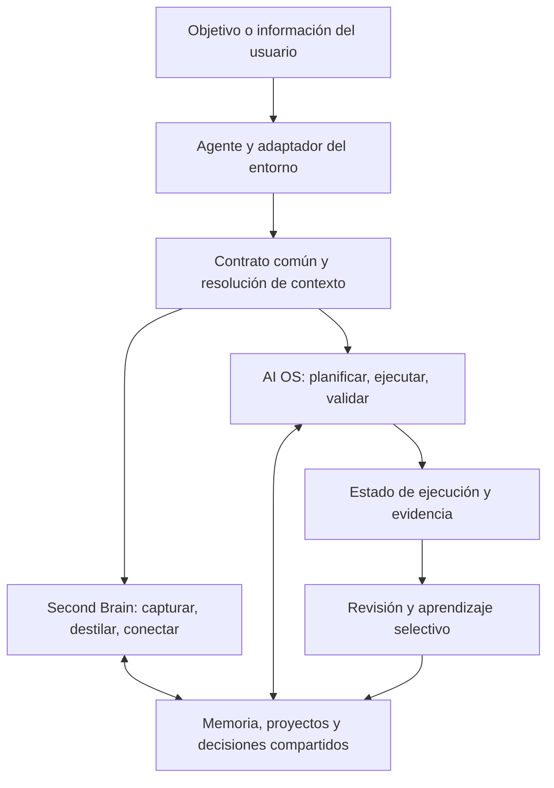

> ANTECEDENTE HISTÓRICO. No establece el estado ni el alcance actuales. Prevalecen [las decisiones vigentes](../docs/decisions.md) y [la arquitectura](../docs/architecture.md). Las recomendaciones antiguas se conservan como contexto.

# Arquitectura base de Second Brain y AI OS

## Propósito y estado

**Referencia vigente para desarrollo:** [Fundamentos y arquitectura del ecosistema](../docs/architecture.md), versión documental 1.0. Este documento v0.2 se conserva como antecedente de diseño; la definición autocontenida y el catálogo de componentes se mantienen en la referencia vigente.

Revisión complementaria: [Propuesta Universal AI OS de ChatGPT y revisión crítica](shared-conversation-review.md). Sus hallazgos informan la siguiente iteración; no modifican automáticamente los contratos de esta versión.

Especificación propuesta para combinar conocimiento duradero, ejecución útil y continuidad entre agentes. Desarrolla la [revisión del instalador original, el vault evolucionado y AIS-OS](installer-review.md). No instala componentes ni cambia las reglas operativas vigentes.

**Alcance aclarado por Manu — v0.2:** el entregable es un repositorio constructor que permite crear y desplegar instancias de Second Brain / AI OS. El vault actual aporta aprendizajes, pero no define el layout ni el backend del producto. Obsidian es una integración opcional. No se exige Markdown, carpetas PARA, hubs, frontmatter ni una aplicación concreta. Esta aclaración sustituye la preferencia por archivos y el layout del vault de la v0.1.

Se distinguen tres objetos: **repositorio constructor** (modelo, blueprints, generador, adaptadores y pruebas), **especificación de instancia** (necesidades, capacidades y destinos elegidos) y **sistema desplegado** (recursos concretos, acceso, workflows y estado). Guardar esta especificación en el vault no vincula el producto a Obsidian.

**Patrón arquitectónico:** núcleo independiente, memoria externa compartida, workflows con contratos y adaptadores por capacidades. El sistema conserva significado, estado y criterios de aceptación cuando cambia el agente que lo utiliza.

**Patrón de construcción:** propósito → conocimiento necesario → proceso → primera ejecución → evidencia → mejora → autonomía si aporta valor.

La portabilidad del contenido es un objetivo general. La compatibilidad de ejecución se declara por adaptador, versión, superficie y capacidades comprobadas. Un entorno sin acceso persistente puede producir una propuesta o un paquete de continuidad, pero no confirmar una escritura que no haya realizado.

## Principios fundamentales

| Principio | Regla de construcción | Evidencia de cumplimiento |
|---|---|---|
| 1. El conocimiento pertenece al usuario | Guardar memoria y estado relevantes en formatos accesibles fuera del chat y de las memorias privadas del proveedor. | Otro entorno recupera el contexto con acceso a las mismas fuentes. |
| 2. Una autoridad por dato o regla | Declarar dónde se mantiene cada hecho, política, workflow y estado. Generar las copias de distribución y las vistas. | Una corrección tiene un lugar de edición claro y sus proyecciones se comprueban. |
| 3. Separar responsabilidades | Distinguir fuente, captura, hipótesis, decisión, conocimiento, estado actual, historial y resultado. | Una propuesta generada no cambia por sí sola una preferencia confirmada. |
| 4. Significado estable, estructura adaptable | Definir entidades y rutas lógicas antes de nombres de carpetas o perfiles. | Una decisión sigue siendo recuperable como decisión en distintos perfiles e idiomas. |
| 5. Contrato antes de ejecución | Definir entradas, resultado, evidencia, efectos permitidos y recuperación de cada workflow. | Se puede aceptar o rechazar una ejecución por criterios previos. |
| 6. Contexto seleccionado por tarea | Recuperar propósito, contexto del proyecto, estado y fuentes relevantes de forma progresiva. | Una consulta encuentra evidencia suficiente sin cargar indiscriminadamente el sistema. |
| 7. Capacidad y autorización explícitas | Comprobar herramientas disponibles y alcance autorizado en la sesión actual. Respetar las autorizaciones vigentes. | El adaptador comunica límites reales y no amplía permisos al cambiar de entorno. |
| 8. Continuidad y cambios comprobables | Persistir pasos, referencias y efectos; comprobar revisiones antes de actualizar. | Se reanuda sin repetir una acción ya confirmada ni pisar una edición concurrente. |
| 9. Evidencia y consolidación selectiva | Validar resultados, conservar procedencia y promover solo aprendizajes útiles. | Una auditoría distingue realizado, demostrado, pendiente y no aplicable. |
| 10. Complejidad proporcional al uso | Empezar con un recorrido completo y un backend adecuado al caso. Añadir especialización, conectores y cadencia por necesidad. | Cada componente resuelve un caso observable y tiene responsable y prueba. |

Los límites expresados en instrucciones orientan al agente; el control técnico depende de los permisos, herramientas y validadores del entorno. La arquitectura debe distinguir estas garantías.

## Dos ciclos sobre una memoria



El Second Brain transforma información en conocimiento recuperable. El AI OS usa ese conocimiento para realizar trabajo y devolver avances comprobados. Ambos usan los mismos proyectos, decisiones y preferencias. El estado de una ejecución pertenece a esa ejecución; el estado general pertenece a la entidad proyecto, cuya vista puede ser una página, registro, dashboard o nota hub.

Una captura puede ir directamente a su destino si está clara. Un trabajo pequeño puede completarse en una sola sesión. La separación conceptual no obliga a generar un archivo por paso.

## Responsabilidades del sistema

Se concretan las seis responsabilidades de [Arquitectura de sistemas con memoria y control](memory-and-control-analysis.md):

| Responsabilidad | Qué contiene | Qué pregunta resuelve |
|---|---|---|
| Propósito y contrato | Objetivos, alcance, políticas y criterios de éxito. | ¿Para qué existe y bajo qué reglas trabaja? |
| Contexto y acceso | Identidad pertinente, mapa de fuentes, búsqueda, procedencia y adaptadores. | ¿Qué necesita saber y cómo lo obtiene? |
| Capacidades y procesos | Workflows, skills, contratos de herramientas y roles opcionales. | ¿Cómo produce el resultado? |
| Memoria y estado | Conocimiento, decisiones, proyectos, ejecuciones y continuidad. | ¿Qué conserva y dónde quedó el trabajo? |
| Control y evaluación | Validaciones, alcance autorizado, evidencia e historial de hallazgos. | ¿Cómo sabe si el resultado sirve? |
| Mantenimiento y evolución | Consolidación, actualización, reparación y mejora verificada. | ¿Cómo conserva utilidad con el tiempo? |

Estas responsabilidades no equivalen a seis agentes ni a seis servicios desplegados.

## Estructura del repositorio de distribución

```text
repository/
├── README.md
├── core/
│   ├── contracts/                 reglas comunes y contratos de operaciones
│   ├── schemas/                   modelo lógico de entidades, relaciones y estado
│   └── protocols/                 recuperación, memoria y continuidad
├── blueprints/                    especificaciones de sistemas que se pueden crear
├── skills/                       fuente mantenida de cada procedimiento
├── modules/
│   ├── second-brain.yaml          composición de capacidades de conocimiento
│   └── ai-os.yaml                 composición de capacidades operativas
├── presets/                      valores iniciales por caso de uso
├── builder/                      diagnóstico, composición y generación del plan
├── adapters/
│   ├── runtimes/                  integración con agentes y sus superficies
│   ├── backends/                  persistencia, búsqueda y relaciones
│   ├── interfaces/                vistas y navegación para la persona
│   └── execution/                 servicios de ejecución y programación opcionales
├── installer/                    aplicar, adoptar, actualizar, reparar y verificar
├── tests/                        fixtures, contratos, recuperación y compatibilidad
├── examples/                     demostraciones con datos sintéticos
└── docs/                         explicación y guía de contribución
```

**Reglas de dependencia:** el núcleo define contratos independientes de marcas; los adaptadores implementan esos contratos. Los blueprints componen módulos y declaran requisitos y aceptación del sistema completo. Las skills piden operaciones sobre entidades y referencias lógicas. Los módulos seleccionan capacidades y dependencias; no mantienen otra copia de sus instrucciones. Los presets aportan valores iniciales y ejemplos, sin cambiar el significado de las entidades. La personalización persistente del usuario prevalece sobre esos valores dentro de las políticas aplicables.

La fuente distribuida de una skill vive en `skills/`. La instalación conserva su versión y las personalizaciones explícitas; los paquetes para entornos se derivan de esa definición efectiva. Una modificación del usuario debe incorporarse o resolverse al actualizar, no perderse al regenerar.

El instalador reutilizaría los contratos pertinentes del Agent-Guided Installer Framework (referencia histórica del vault; no necesaria para implementar). Su código y disponibilidad deberán comprobarse antes de tratarlo como dependencia implementada.

## Estructura lógica del sistema desplegado

Toda instancia contiene propósito y políticas, memoria y relaciones, capacidades, estado de trabajo, acceso humano/agente y evidencia de funcionamiento. Su representación física depende del destino: documentos, registros, tablas, objetos o una combinación con autoridad declarada para cada entidad.

| Eje independiente | Qué se elige | Ejemplos de destinos posibles, no implementados |
|---|---|---|
| Runtime de agente | Quién interpreta y ejecuta los procedimientos. | Codex, Claude Code, Cowork u otro agente con adaptador. |
| Backend | Dónde persisten entidades, relaciones y estado. | Archivos, SQLite, Postgres o una plataforma documental accesible por API. |
| Interfaz humana | Cómo se consulta y modifica el sistema. | Obsidian sobre archivos, Notion, una app web o una CLI. |
| Ejecución | Dónde corren tareas y, si hace falta, su programación. | Sesión interactiva, proceso local o servicio alojado. |

Una herramienta puede cubrir varios ejes. Notion puede aportar persistencia e interfaz; Obsidian puede presentar una persistencia basada en archivos. Separar responsabilidades no obliga a desplegar servicios independientes.

El modelo común reutiliza [Universal Backend Model](backend-model.md): entidades, relaciones, consultas, permisos, revisiones y comprobaciones. Los adaptadores declaran capacidades soportadas, emuladas y ausentes. Una carencia obligatoria bloquea ese plan o exige elegir una alternativa explícita; no se degrada silenciosamente el significado o la garantía solicitada.

La instancia mantiene un manifiesto con identidad, versión, selección de módulos/adaptadores, recursos gestionados, configuración efectiva y verificaciones. Puede almacenarse como archivo o registro según el despliegue. Los estados de ejecución son persistentes; los índices derivados son reconstruibles. El formato de intercambio y la correspondencia entre identificadores se definen para permitir exportar, importar y verificar equivalencia entre backends.

Obsidian tendría un adaptador o perfil de despliegue que traduzca entidades a notas y relaciones a enlaces. Solo ahí se elegirían carpetas, frontmatter y hubs. Ningún workflow del núcleo exigiría esas convenciones.

## Proceso del constructor

```text
Necesidad del usuario
→ blueprint y módulos pertinentes
→ especificación de instancia
→ comprobación de capacidades y acceso de los destinos
→ plan de recursos, configuración y cambios
→ aplicación dentro de la autorización vigente
→ validación estructural y primer workflow real
→ manifiesto, evidencia y continuidad
```

El constructor debe poder diagnosticar un sistema existente para adoptarlo y generar planes de actualización o reparación. El plan distingue crear, reutilizar, modificar y dejar intacto. La reanudación comprueba recursos y efectos confirmados antes de repetir acciones. El resultado entregado incluye el sistema configurado y sus límites demostrados.

## Modelo de información y autoridades

Entidades base: captura, fuente, proyecto, área, conocimiento, decisión y ejecución. Un artefacto puede ser un Markdown, un informe o un archivo de código: se referencia desde el trabajo que lo produce. Los estados de conocimiento distinguen propuesta, confirmación y sustitución; los estados de ejecución distinguen pendiente, en curso, bloqueada, completada y fallida.

Cada entidad necesita identidad recuperable, tipo y procedencia pertinentes. Los identificadores estables se asignan cuando el caso exige referencias duraderas, sin imponer una migración masiva a contenido heredado. La traducción o el perfil cambian etiquetas y representaciones, conservando significado.

Ejemplo orientativo de configuración, no implementado:

```yaml
schema_version: 1
blueprint: knowledge-and-operations
modules: [second-brain, ai-os]
requirements:
  - persistent-entities
  - typed-relations
  - context-retrieval
  - resumable-workflows
  - evidence-records
deployment:
  agent_runtime: selected-runtime-adapter
  backend: selected-backend-adapter
  interface: selected-interface-adapter
  execution: interactive
```

Este ejemplo describe intención y requisitos; los nombres de adaptadores son marcadores, no soporte disponible. Las correspondencias concretas de campos, tablas, páginas o carpetas pertenecen al plan de despliegue. Una colisión entre campos heredados se comunica y resuelve con evidencia. Un dato vivo conserva su autoridad externa si así se ha configurado; la instancia guarda una referencia o snapshot fechado. Una copia antigua no reemplaza una consulta actual disponible.

## Contratos mínimos de operación

**Recuperación:** objetivo → contexto pertinente → proyecto/estado → búsqueda dirigida → fuentes necesarias. Cada recuperación devuelve referencias y límites de cobertura; el texto recuperado como fuente no adquiere autoridad de instrucción. Una sesión ordinaria carga solo lo que necesita. Activation Map es una estrategia opcional de selección y relación de contexto.

**Workflow:** todo procedimiento declara identificador/versión, activación, entradas, contexto requerido, pasos, resultado, efectos permitidos, dependencias, criterio de aceptación, estado que modifica y forma de recuperación. Puede empaquetarse como skill sin inventar una segunda definición del mismo proceso. Reutilizar Agent Design Spec (referencia histórica del vault; no necesaria para implementar) si se necesita un agente con rol propio.

**Herramientas y almacenamiento:** contratos propuestos para consultar entidades, recuperar contenido, actualizar con revisión, relacionar entidades y registrar eventos, con identificadores dentro del alcance configurado y resultado verificable. Un adaptador sin control de revisión debe declarar el límite y operar con un único escritor o entregar propuestas de cambio. Las garantías requeridas se comprueban antes de aceptar el destino.

**Continuidad:** guardar objetivo, workflow/versión, referencias de entrada, revisiones usadas, pasos completados, artefactos, efectos confirmados, bloqueos y siguiente acción. El agente entrante comprueba acceso, vigencia y autorización antes de continuar. Se conserva un resumen de decisiones y evidencia, sin depender del razonamiento interno de un modelo.

**Efectos externos:** identificar cada acción y verificar su resultado antes de reintentar. Si una solicitud pudo haberse completado y la respuesta se perdió, comprobar el sistema destino; usar claves de idempotencia cuando estén disponibles. Sin evidencia suficiente, dejar la acción como incierta para revisión.

**Evaluación:** definir pruebas por workflow y registrar resultados con evidencia. Separar defecto confirmado, falta de prueba y requisito no aplicable. Cerrar hallazgos con nueva evidencia y conservar el historial.

## Portabilidad entre ecosistemas

| Modo según capacidades | Compromiso del sistema |
|---|---|
| Consulta o preparación | Lee el contexto disponible y devuelve análisis o un paquete para aplicar después. |
| Operación persistente | Lee y escribe el mismo almacenamiento autorizado, valida cambios y conserva continuidad. |
| Operación con herramientas externas | Añade solo las conexiones verificadas y acciones autorizadas. |
| Operación recurrente | Añade un scheduler real, acceso a las fuentes durante la ejecución y registro de resultados. |

Los modos se determinan por la sesión, no por el nombre comercial. El adaptador comprueba acceso real, descubrimiento de skills, escritura, validación y límites. La compatibilidad significa conservar contratos y alcanzar resultados equivalentes dentro de esas capacidades; no exige textos generados idénticos.

Ejemplos actuales de distribución: Codex documenta `AGENTS.md` y `.agents/skills`; Claude Code documenta `.claude/skills`; Cowork ofrece instalación de plugins. Estas convenciones justifican adaptadores distintos. Fuentes oficiales consultadas el 2026-09-08: [Codex](https://learn.chatgpt.com/es-419/docs/customization/overview), [Claude Code](https://code.claude.com/docs/en/skills), [Cowork](https://claude.com/docs/cowork/guide/plugins).

El acceso compartido también debe resolverse. Para una primera versión, usar un almacenamiento común y un escritor por tarea. Entre dispositivos se requiere sincronización o un servicio de almacenamiento con detección de conflictos. Copiar un repositorio a dos sitios no crea automáticamente memoria coherente. MCP puede exponer operaciones comunes donde resulte necesario; no sustituye el modelo de datos ni la verificación.

## Construcción por incrementos verificables

| Incremento | Entrega | Prueba de salida |
|---|---|---|
| 1. Modelo y blueprint | Entidades, autoridades, capacidades y criterios del caso inicial. | La especificación no exige una herramienta ni un layout concreto. |
| 2. Memoria útil | Captura, recuperación y actualización de un proyecto. | Una sesión nueva encuentra una decisión y su origen. |
| 3. Workflow completo | Un resultado útil, por ejemplo un brief con fuentes. | Cumple criterios y deja siguiente paso sin guardar ruido. |
| 4. Continuidad | Estado persistente y detección de cambios. | Interrumpir/reanudar no duplica acciones ni pisa una edición. |
| 5. Portabilidad de agente y backend | Segundo runtime y segundo backend de distinta representación. | Recupera significado y estado equivalentes; exportación/importación conserva identidad, relaciones y procedencia. |
| 6. Construcción y adopción | Generar planes; crear, adoptar, actualizar, reparar y verificar. | Un destino vacío funciona y uno existente conserva datos y personalizaciones. |
| 7. Mejora operativa | Auditoría y corrección de un defecto conocido. | La segunda prueba demuestra reparación sin borrar el historial. |
| 8. Expansión necesaria | Conector, especialización o cadencia. | El caso adicional funciona en las condiciones reales de ejecución. |

La primera implementación puede ser un único repositorio modular. El primer backend se elige por el caso piloto; un segundo backend de representación distinta debe probar pronto que el modelo es independiente. La validación automatizable de esquemas, relaciones, versiones y escritura pertenece a código; las tareas de síntesis y clasificación pueden apoyarse en el agente. No se necesita comenzar implementando todos los destinos.

## Ejemplo de uso completo

Una persona usa el repositorio para crear un sistema de investigación y preparación de propuestas. El constructor compone un blueprint y verifica los adaptadores elegidos. Según el backend, genera registros, documentos o archivos; según la interfaz, configura las vistas o navegación pertinentes. Verifica un primer recorrido y entrega la instancia y su manifiesto.

En esa instancia, el agente consulta el contrato, recupera el proyecto, sus decisiones y fuentes, genera un borrador y comprueba sus requisitos. Otro agente con acceso al mismo backend continúa desde el estado persistido. Una decisión final se actualiza con procedencia y el aprendizaje reutilizable se incorpora a conocimiento. El workflow mantiene su contrato al desplegar otra instancia sobre un backend distinto, sin exigir una carpeta de Knowledge. Enviar la propuesta exige autorización y un conector disponible.

## Activation Map y continuidad

- Regiones activadas: AutoBrain y Second Brain (alta); arquitectura e instaladores de agentes (alta).
- Reutilización: revisión anterior, Arquitectura de sistemas con memoria y control, Agent Design Spec, Knowledge Flow (referencia histórica del vault; no necesaria para implementar), Project States (referencia histórica del vault; no necesaria para implementar) y Neural Vault Protocol (referencia histórica del vault; no necesaria para implementar).
- Nueva nota: especificación aplicada al proyecto existente, separada de los hallazgos de investigación.
- Conexiones aplicadas: la revisión alimenta esta especificación; esta especificación concreta las responsabilidades del framework anterior.
- Conexiones propuestas: adopción como base de implementación y reutilización de contratos del framework instalador. Pendientes de validación práctica.
- Límite: estructura propuesta, sin scaffolding, paquetes instalados ni cambios de manuales. Se guarda en el vault local; no se publica contenido.

Siguiente paso: definir el blueprint y modelo lógico del primer recorrido captura → recuperación → brief → continuidad, y verificarlo en dos representaciones de almacenamiento. Esta prioridad actualiza la v0.1 y coincide con la decisión existente de diseñar primero un modelo de backend independiente (referencia histórica del vault; no necesaria para implementar).


[Volver a la entrada del proyecto](../README.md)
